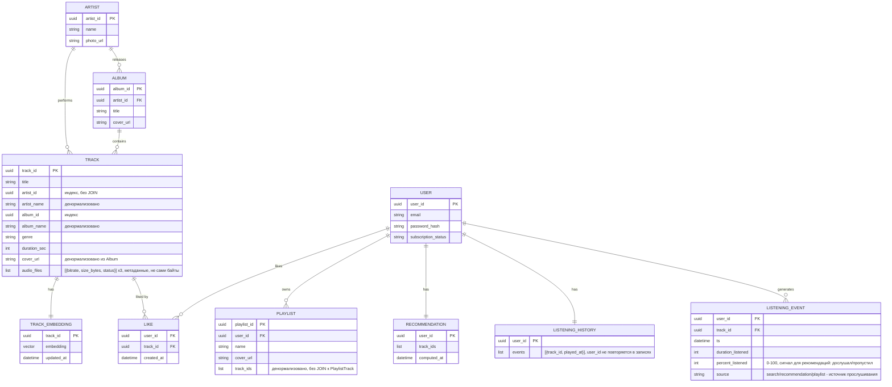
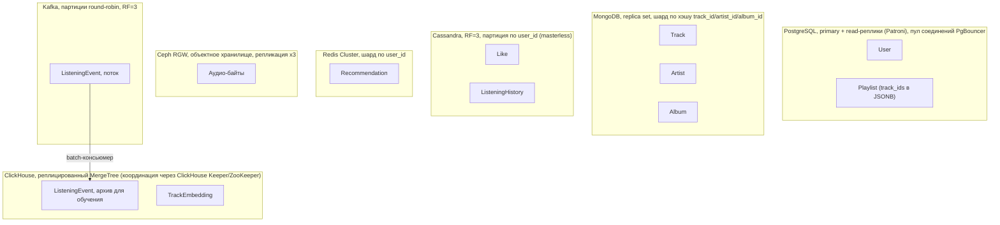
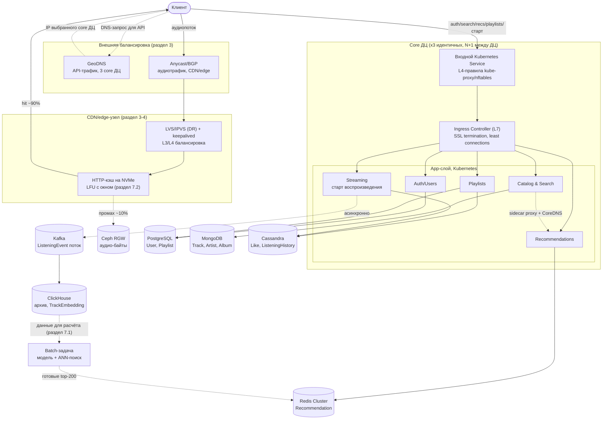

# Рассчётно-пояснительная записка для Курсовой работы по предмету "Проектирование высоконагруженных систем"

## 1. Тема и целевая аудитория

**Тип сервиса**: Музыкальный стриминг (аналог Яндекс.Музыка)

**Основной функционал MVP**: 
1) Регистрация/авторизация пользователя;
1) Возможность прослушивания треков;
1) Рекомендательная система для подбора треков по предпочтениям пользователя;
2) Поиск музыки;
4) Плейлисты.

**Ключевые продуктовые решения**: 
1) Поиск сразу по исполнителю и названию;
2) Рекомендательная система предварительно вычисляет наиболее вероятный список треков для пользователя.

**Ключевые функции, характеризующие сервис**: 
1) Прослушивание музыки;
2) Рекомендации музыки.

**Целевая аудитория**: ~30.5 млн человек в месяц. Основная часть аудитории сосредоточена в России (~95%) и Беларуси (~1.5%), остальные – другие страны СНГ. [^1]

## 2. Расчет нагрузки

### Продуктовые метрики


|Тип метрики | Величина|
|:--|:--|
|MAU | 30.5 млн.|
|DAU| 15-16 млн. (30.5 * 0.5) |

Коэффициент для DAU получен исходя из того, что в среднем Яндекс Плюс пользуются 21 день в месяц [^2], то есть коэффициент 21 / 30 = 0.7. С учетом того, что Яндекс Плюс использует больше людей, немного уменьшим коэффициент для Яндекс.Музыки.

Далее для всех расчетов будем использовать DAU = 15,5 млн.

**Среднее количество действий DAU-пользователя в день, по типам**

Типы действий выбраны исходя из функционала MVP: прослушивание, рекомендации, поиск, плейлисты, авторизация.

|Тип действия | Количество в день на пользователя|
|:--|:--|
|Воспроизведение трека| ~ 12|
|Запрос рекомендаций| ~ 3|
|Поисковый запрос| ~ 1,5|
|Действие с плейлистом (создание/добавление трека)| ~ 1|
|Авторизация / обновление сессии| ~ 1|

Расчет количества прослушанных треков: по данным исследования РОМИР, 78% пользователей музыкальных стримингов в городах России проводят с сервисом более 30 минут в день [^3]. Поскольку это пороговое, а не среднее значение, для расчета берется оценка среднего времени прослушивания 40 минут в день на DAU-пользователя. Средняя длительность трека, по данным исследования, в 2020 году (данные Spotify) составила 3 минуты 17 секунд ~ 3,3 минуты [^4]. Тогда среднее число прослушанных треков в день: 40 / 3,3 ~ 12.

Частота обращений к поиску, рекомендациям, плейлистам и авторизации не публикуется сервисами в открытых источниках, поэтому эти величины приняты как оценки.

### Технические метрики

**Размер хранения в разбивке по типам данных**

Оценка размера каталога: по данным Forbes.ru, по состоянию на 2023 год каталог «Яндекс Музыки» насчитывал более 76 млн треков [^5]. Официальный Transparency Report сервиса указывает, что каталог еженедельно пополняется примерно на 80 тыс. единиц лицензионного контента [^6]. Считая пополнение на 2 года (104 недели): 76 + 0,08 * 104 ~ 84,3 млн, округлим до 85 млн треков.

Для адаптивного воспроизведения сервис хранит несколько версий трека под разный битрейт — режимы «Экономичное» (HE-AAC, 64 кбит/с), «Оптимальное» (AAC, 192 кбит/с) и «Превосходное» (MP3 320 кбит/с либо FLAC) [^7]. Для расчета примем упрощенно 3 сохраняемые версии на трек: 64 / 192 / 320 кбит/с. При средней длительности трека 3,3 минуты (200 сек) [^4] размер файла на каждый битрейт: 64 кбит/с -> 1,6 МБ; 192 кбит/с -> 4,8 МБ; 320 кбит/с -> 8,0 МБ; итого ~ 14,4 МБ на трек (все версии).

Метаданные каталога на трек (5 КБ) — инженерная оценка, без внешнего источника: текстовые поля (название, исполнитель, альбом, жанр, теги) ~ 1-2 КБ + вектор эмбеддинга трека для рекомендательной модели ~ 2 КБ. Эмбеддинг нужен, поскольку ключевое продуктовое решение сервиса — предвычисление рекомендаций: модель ищет похожие треки через сравнение векторов, а не перебором каталога.

|Тип данных | Количество единиц | Размер на единицу | Итого|
|:--|:--|:--|:--|
|Аудиофайлы каталога (3 версии битрейта на трек)| 85 млн треков| 14,4 МБ| ~ 1224 ТБ (1,2 ПБ)|
|Метаданные каталога | 85 млн треков| 5 КБ| ~ 0,4 ТБ|
|Пользовательские данные (профиль, лайки, плейлисты, история), MAU| 30,5 млн| 0,15 МБ| ~ 4,6 ТБ|
|Предвычисленные рекомендации (топ-200 треков на пользователя), MAU| 30,5 млн| 2,4 КБ| ~ 0,07 ТБ|
|**Итого**| | | ~ 1230 ТБ (~ 1,23 ПБ)|


|Тип метрики | Величина|
|:--|:--|
|Хранилище на 1 пользователя, метаданные|0.15 Мб|
|Хранилище на 1 пользователя, оффлайн-кэш|0.25 Гб|

Значения для хранилища на пользователя — оценки без внешнего источника. Метаданные (0.15 МБ = 150 КБ): профиль и настройки (~1 КБ) + лайки и подписки на артистов (~2 КБ) + плейлисты (~2 КБ) + история прослушиваний (~145 КБ при 12 байт на событие — id трека + таймстемп). Офлайн-кэш (0.25 ГБ) — это ~30-50 скачанных треков в среднем качестве (при 4,8-8 МБ/трек), то есть 1-2 плейлиста [^7]; он хранится на устройстве пользователя и в серверное хранилище ниже не входит.

**RPS в разбивке по типам запросов**

Средний RPS = (DAU \* количество действий данного типа в день) / 86 400 сек. 

|Тип запроса | Средний RPS | Пиковый RPS|
|:--|:--|:--|
|Воспроизведение трека| ~ 2153| ~ 5383|
|Запрос рекомендаций| ~ 538| ~ 1345|
|Поиск| ~ 269| ~ 673|
|Операции с плейлистом| ~ 179| ~ 448|
|Авторизация| ~ 179| ~ 448|
|**Итого**| ~ 3318| ~ 8297|

**Сетевой трафик**

Примем распределение DAU-пользователей по качеству звука: 20% - «Экономичное» (64 кбит/с), 60% - «Оптимальное» (192 кбит/с), 20% - «Превосходное» (320 кбит/с) [^7]. Средневзвешенный битрейт потока: 0,2\*64 + 0,6\*192 + 0,2\*320 = 192 кбит/с.

Суммарное время прослушивания в сутки: DAU \* 40 мин = 15,5 млн \* 40 мин = 620 млн человеко-минут/сутки = 37,2 млрд человеко-секунд/сутки. Средняя нагрузка = 37,2\*10^9 сек \* 192 000 бит/с / 86 400 сек ~ 82,7 Гбит/с; суммарный суточный объем ~ 893 ТБ/сутки.

Прослушивание распределено по суткам неравномерно (пики в утренние/вечерние часы). Примем коэффициент пик/среднее ~ 2,5 для сервисов с выраженной суточной цикличностью (аудитория сервиса сосредоточена в РФ). Пиковая нагрузка (аудио) ~ 82,7 \* 2,5 ~ 207 Гбит/с.

Трафик API (поиск, рекомендации, плейлисты, авторизация, метаданные для старта воспроизведения) считается как RPS каждого типа запроса (см. таблицу RPS ниже) x средний размер payload'а запроса/ответа. Размеры payload'ов — оценки: старт воспроизведения (ссылка на файл) ~ 2 КБ, ответ с рекомендациями (список треков с метаданными) ~ 10 КБ, ответ поиска ~ 5 КБ, операция с плейлистом ~ 1 КБ, авторизация ~ 1 КБ. Пиковый трафик = сумма(пиковый RPS x размер payload'а x 8 бит/байт) ~ 86 + 108 + 27 + 3,6 + 3,6 ~ 228 Мбит/с ~ 0,2 Гбит/с. Суточный объем = сумма(средний RPS x размер payload'а x 86 400 сек) ~ 984 ГБ/сутки ~ 1 ТБ/сутки.

|Тип трафика | Пиковое потребление, Гбит/с | Суммарный суточный объем, ТБ/сутки|
|:--|:--|:--|
|Аудиопоток (стриминг)| ~ 207| ~ 893|
|API-запросы (поиск, рекомендации, плейлисты, авторизация, метаданные для старта воспроизведения)| ~ 0,2| ~ 1|
|**Итого**| ~ 207| ~ 894|

### Прирост метрик

|Метрика | Сейчас | Прирост за год|
|:--|:--|:--|
|MAU| 30,5 млн| +32% (~ +9,8 млн; ~ 27 тыс./сутки)|
|DAU| 15,5 млн| +32% (~ +5,0 млн; ~ 14 тыс./сутки)|
|Каталог| 85 млн треков| +4,9% (~ +4,16 млн; ~ 11,4 тыс./сутки)|
|Аудиофайлы каталога| ~ 1224 ТБ| ~ +60 ТБ (~ 0,16 ТБ/сутки)|
|Метаданные каталога| ~ 0,4 ТБ| ~ +0,02 ТБ (~ 0,06 ГБ/сутки)|
|Пользовательские данные| ~ 4,6 ТБ| +32% (~ +1,5 ТБ; ~ 4 ГБ/сутки)|
|Предвычисленные рекомендации| ~ 0,07 ТБ| +32% (~ +0,02 ТБ; ~ 0,06 ГБ/сутки)|
|**Итого хранилище**| ~ 1230 ТБ| ~ +61,4 ТБ, +5% (~ 0,17 ТБ/сутки)|
|Пиковый сетевой трафик (аудио)| ~ 207 Гбит/с| +32% (~ +66 Гбит/с)|
|Суточный объем трафика| ~ 894 ТБ/сутки| +32% (~ +286 ТБ/сутки)|
|Средний RPS (суммарно)| ~ 3318| +32% (~ +1062)|
|Пиковый RPS (суммарно)| ~ 8297| +32% (~ +2655)|

Рост аудитории +32% за год взят из источника [^1]. Для прогноза на год вперед принято допущение, что темп роста сохранится. Трафик, RPS, пользовательские данные и рекомендации растут пропорционально аудитории (поведение пользователя не меняется): прирост = текущее значение \* 0,32; для данных на пользователя — прирост MAU \* размер на пользователя (9,76 млн \* 0,15 МБ ~ 1,5 ТБ). Прирост каталога — по Transparency Report [^6]: ~ 80 тыс. единиц контента в неделю, то есть 80 000 \* 52 = 4,16 млн треков в год; прирост аудиофайлов = 4,16 млн \* 14,4 МБ ~ 60 ТБ, метаданных = 4,16 млн \* 5 КБ ~ 0,02 ТБ.

## 3. Глобальная балансировка нагрузки

**Функциональное разбиение по доменам**

|Домен | Описание | Требования|
|:--|:--|:--|
|Auth/Users| профиль, сессии, подписки| консистентность записи|
|Catalog & Search| каталог треков, поиск| read-heavy, кэшируется|
|Recommendations| предвычисленные подборки (раздел 2)| read-heavy, пересчёт офлайн|
|Playlists| плейлисты, лайки| консистентность записи, низкий трафик|
|Streaming| доставка аудиофайлов| доминирует по трафику|
|Listening log| события прослушивания для ML| write-heavy|

Из раздела 2: пиковый трафик Streaming ~ 207 Гбит/с против ~ 0,2 Гбит/с у всех остальных доменов вместе (API-запросы). То есть только Streaming достаточно тяжелый, чтобы обосновать вложения в географически распределенную инфраструктуру (edge/CDN); остальные домены можно централизовать в несколько core ДЦ.

**Обоснование расположения ДЦ**

Аудитория: 95% РФ, 1,5% Беларусь, ~3,5% другие страны СНГ [^1]. Внутри РФ ~70% населения живет в европейской части (25% территории), ~30% — в азиатской (Урал, Сибирь, Дальний Восток, 75% территории) [^9]. Крупнейшая точка обмена трафиком в РФ — MSK-IX (Москва), топ-5 в мире по трафику (пик 8,7 Тбит/с), с узлами в Москве и региональными площадками (Петербург, Казань, Екатеринбург и др.) [^8]. На практике Яндекс размещает основные ЦОДы кластером в 100-300 км от Москвы (Владимир, Сасово, Калуга), рядом с MSK-IX и основной массой пользователей, а не распределяет их по стране [^10].

Решение: 3 core ДЦ в Центральном федеральном округе (active-active-active, для отказоустойчивости) — обслуживают все домены, кроме Streaming. Streaming раздается через сеть CDN-узлов (Anycast) в региональных точках обмена (Москва, Петербург, Екатеринбург, Новосибирск — для снижения задержки в азиатской части РФ) плюс пиринг в Минске и Алматы для аудитории СНГ. Отдельный core ДЦ для СНГ не обоснован: 3,5% аудитории не окупают капитальные затраты, достаточно edge-узла и пиринга.

**Расчет распределения запросов по ДЦ**

API-трафик (auth, search, recs, playlist, старт стрима — из раздела 2: средний RPS ~ 3318, пиковый ~ 8297, ~ 0,2 Гбит/с) обслуживается 3 core ДЦ. Формула резервирования — N+1 на уровне ДЦ (раздел 4): под обычной нагрузкой трафик делится поровну на все 3 (~ 1106 / 2766 RPS на ДЦ), но каждый ДЦ должен быть provisioned на 50% пика (~ 1659 / 4149 RPS) — именно столько придется принять на себя оставшимся двум, если третий откажет.

Аудиотрафик (207 Гбит/с пик) в основном раздается с CDN, а не из core. Примем коэффициент ~ 90% — оценка без источника, обоснована тем, что малая доля треков дает большую часть прослушиваний. Тогда CDN отдают ~ 90% = 186 Гбит/с (кэш популярных треков), а core ДЦ (промахи кэша, отдача из объектного хранилища) — оставшиеся ~ 10% = 21 Гбит/с: номинально ~ 7 Гбит/с на ДЦ при равномерном делении на 3, но provisioning на 50% (10,5 Гбит/с на ДЦ) — на случай отказа одного из трех.

**Схема DNS-балансировки (GeoDNS)**

Используется для доступа к core ДЦ (auth, catalog, recs, playlists):

```
Клиент -> локальный DNS-резолвер -> авторитативный GeoDNS
       -> определяет регион резолвера и живой (health-check) ДЦ
       -> возвращает IP ближайшего/доступного core ДЦ (ДЦ-1, ДЦ-2 или ДЦ-3)
Клиент -> подключается напрямую по полученному IP
```

Слабое место — кэширование ответа на стороне резолвера/клиента (TTL): переключение при отказе ДЦ происходит не мгновенно [^11].

**Схема Anycast-балансировки**

Используется для CDN-узлов, раздающих аудиопоток: один и тот же IP-префикс анонсируется по BGP одновременно из всех точек присутствия (Москва, Петербург, Екатеринбург, Новосибирск, Минск, Алматы). DNS возвращает Anycast-адрес, а выбор площадки определяется сетевыми маршрутами и политиками BGP, а не точным географическим расстоянием [^11]. При отказе площадки её анонс должен быть отозван; переключение не ждёт истечения DNS TTL, но требует обнаружения отказа и сходимости маршрутов. Установленные соединения могут оборваться и потребовать повторного подключения.

**Механизм регулировки трафика между ДЦ**

- Core ДЦ (GeoDNS): health-check каждые N секунд; при отказе ДЦ его IP исключается из ответов, TTL записи снижен (например, до 30-60 сек) для быстрого переключения.
- Плановое перераспределение нагрузки (релизы, обслуживание) — постепенный перевод DNS-ответов/BGP-анонсов, а не резкое переключение.

## 4. Локальная балансировка нагрузки

App-серверы доменов — stateless (масштабируются балансировкой), БД — stateful; схема чтения и записи зависит от СУБД (раздел 6). App-слой разворачиваем в Kubernetes: отдельно устанавливаем **NGINX Ingress Controller** (проект nginx/kubernetes-ingress, вариант с NGINX Open Source [^19]) для L7. Для Kubernetes Service **kube-proxy** настраивает L4-правила в ядре; выбран режим nftables на совместимых Linux-узлах [^20].

**Уровни и резервирование**

```
Клиент -> L4-правила входного Service (kube-proxy/nftables) -> L7 (NGINX Ingress Controller, TLS termination, роутинг)
       -> App-под домена -> межсервисные вызовы (sidecar proxy) -> нужная СУБД (раздел 6)
```

Здесь выбран вход через Service ingress-controller. Контроллер направляет запросы к pod-адресам нужного сервиса; повторный проход через ClusterIP app-сервиса не обязателен. kube-proxy программирует правила, а не выступает отдельным последовательным HTTP-прокси.

|Уровень | Формула | Что переживает|
|:--|:--|:--|
|L4 / L7 / App-под / read-реплика (внутри ДЦ)| N+1| отказ одного узла|
|3 core ДЦ (раздел 3, между ДЦ)| N+1 на уровне ДЦ| отказ одного ДЦ целиком|

N+1 — минимум под нагрузку плюс один запасной элемент. "Элемент" может быть и отдельной машиной (внутри ДЦ), и целым ДЦ (между ДЦ) — формула та же, просто единица резервирования другая. При 3 ДЦ: под пиковую нагрузку в сумме нужно 2 ДЦ-эквивалента (каждый provisioned на 50% пика), третий — запасной; любые 2 из 3 вместе вытягивают 100%. Суммарно провижинится ~150% пиковой мощности — дешевле, чем N x 2 (две полностью независимые копии по 100% каждая, то есть 200%, или 300% для трех копий).

Отдельно стоит отметить: с ровно 2 ДЦ формулы N+1 и N x 2 физически совпадают — если нужна гарантия "1 из 2 ДЦ один вытянет всё", этот один ДЦ по-любому должен быть provisioned на 100%, другого способа нет. Разница между формулами становится ощутимой только от 3 единиц резервирования и больше — именно поэтому переход на 3 ДЦ даёт реальную экономию (150% вместо 200%), а не просто "на всякий случай".

**L3/L4: выбор способа (LVS/IPVS) — отдельный балансировщик перед edge/CDN**

Это не kube-proxy (он только для core ДЦ, см. выше) — для раздачи аудио стоит отдельный, специально настроенный LVS/IPVS-балансировщик вне Kubernetes, и вот для него способ выбирался осознанно:

|Способ | Ответ сервера | Нагрузка на LB|
|:--|:--|:--|
|NAT| идёт обратно через LB| высокая|
|IP Tunneling | идёт клиенту напрямую| только входящий трафик, но есть накладные расходы на инкапсуляцию/декапсуляцию на каждый пакет|
|Direct Routing (DR, меняется MAC, не IP)| идёт клиенту напрямую| LB обрабатывает входящие пакеты, объёмный ответ обходит его|

Берём DR: при 186 Гбит/с суммарного исходящего аудиотрафика важно, чтобы ответ обходил LB. Входящие пакеты всё равно требуют CPU и пропускной способности; пределы по PPS/CPS и сеть проверяются отдельно. Серверы и балансировщик каждой CDN-площадки размещаются в общей L2-сети. Для API в core ДЦ (~0,2 Гбит/с) используются правила Service kube-proxy/nftables, отдельный DR-балансировщик не нужен. Для выделенного LVS-балансировщика keepalived выполняет проверки и VRRP-переключение виртуального IP на резервный узел.

**Входящие запросы (L7)**: настраиваем least connections (least_conn), поскольку время обработки поисковых запросов различается. Число активных соединений — приближение занятости, а не точная загрузка сервера; преимущество перед round-robin проверяется на целевом профиле нагрузки. Разбор случайной маршрутизации [^12] иллюстрирует риск очередей, но сам по себе не доказывает превосходство алгоритма для нашего сервиса.

**Межсервисные запросы**: sidecar proxy на стороне вызывающего сервиса получает адреса готовых экземпляров через discovery (например, headless Service с DNS-именем в CoreDNS) и применяет настроенную балансировку без возврата к внешнему Ingress. CoreDNS разрешает имена; готовность pod определяется проверками Kubernetes, а оценка занятости — политикой прокси.

**Схема отказоустойчивости**

|Что отказало | Кто обнаруживает | Что происходит|
|:--|:--|:--|
|L4/L7/app-узел| health-check| узел исключается, N+1 покрывает|
|Read-реплика БД| health-check| чтение уходит на оставшиеся (N+1)|
|Весь core ДЦ| внешние health-check, обновление GeoDNS (раздел 3)| оставшиеся 2 из 3 ДЦ принимают по 50% пика (N+1); переключение зависит от DNS-кэшей и доступности реплик данных|
|CDN-сервер / вся edge-площадка| локальные проверки / отзыв BGP-анонса| сервер исключается локально; при потере площадки маршруты сходятся к другой, клиенту может потребоваться повторное подключение|

**Расчет количества балансировщиков**

Два разных домена — два разных ограничителя, потому что у них разная природа трафика: у API-слоя (Auth/Catalog&Search/Recommendations/Playlists) много коротких запросов — упирается в стоимость SSL-хендшейка (SSL Termination); у Streaming — мало длинных соединений, но огромный объем данных — упирается в пропускную способность сети, а не в хендшейки (внутри одного HTTPS-соединения качается много сегментов подряд, новый хендшейк не на каждый сегмент).

*API-слой (core ДЦ), ограничитель — SSL Termination.* По тестам nginx на Intel Xeon E5-2699 v3 (36 ядер), для HTTPS с 2048-bit RSA пропускная способность по установлению соединений (CPS) выходит на плато около 24 ядер и достигает ~10 274 CPS [^16]; похожий выход на плато после 16-24 ядер виден и в отдельном тесте TPS для nginx ingress controller [^17], то есть это не случайность конкретного теста, а общая особенность масштабирования SSL/TLS-обработки на многоядерных машинах. Округлим до 10 000 CPS на 1 узел (консервативно, без учета TLS session resumption, которая на практике снижает долю "дорогих" полных хендшейков [^18]). Пиковый RPS, под который provisioned один core ДЦ — 4149 (раздел 3: это не номинальная 1/3 от 8297 при здоровых всех трех ДЦ, а расчет на отказ одного из трех — оставшиеся два должны вместе вытянуть 100%, то есть по 50% = 4149 каждый). Считаем "от худшего": каждый запрос — новое соединение. Нужно узлов: 4149 / 10 000 ~ 0,41 -> округляем вверх до 1; с резервированием N+1 -> 2 узла на ДЦ, итого 6 узлов на все 3 core ДЦ.

*Edge/CDN-слой, ограничитель — пропускная способность сети.* Пиковый аудиотрафик с edge/CDN-узлов — 186 Гбит/с (раздел 3, 90% от 207 Гбит/с). При условной пропускной способности одного узла 10 Гбит/с (например, агрегированный канал 2x10GbE) — нужно узлов: 186 / 10 = 18,6 -> округляем до 19. Эти узлы физически распределены по ~4 точкам присутствия (Москва, Петербург, Екатеринбург, Новосибирск), то есть в среднем ~5 узлов на точку; добавляя резервирование N+1 в каждой точке отдельно (а не один общий запасной на всю сеть — точки физически разделены и не могут "одолжить" мощность друг у друга при отказе) — итого около 19 + 4 = 23 узла.

*Вывод.* Нагрузка на "офисный" API-слой (core ДЦ) по факту небольшая — 6 узлов против 23 на edge/CDN — это согласуется с выводом раздела 3, что только Streaming достаточно тяжелый, чтобы требовать серьезной инфраструктуры; edge/CDN-слой требует заметно больше узлов именно из-за объема данных, а не из-за числа запросов.

## 5. Логическая схема БД

Схема — без привязки к конкретной СУБД и без шардинга. По правилам лекции (денормализация, без JOIN, шард по PK): Track хранит имя исполнителя/альбома/обложку денормализованно (быстрое чтение без похода в Artist/Album), но Artist и Album все равно существуют как отдельные сущности — это authoritative источник данных (в т.ч. фото, которое незачем дублировать в каждом треке этого исполнителя), а artist_id/album_id в Track — это просто индекс для группировки ("все треки исполнителя"), не JOIN. Вектор эмбеддинга вынесен в отдельную TRACK_EMBEDDING: его не читает обычный поиск/показ трека (не нужно таскать 2 КБ лишних данных при каждом из 6056 чтений Track в пике), нужен только batch-пересчету рекомендаций, и меняется по своему графику (переобучение модели), не связанному с изменением метаданных трека. Аудиофайлы — не отдельная сущность схемы: сами байты лежат в объектном хранилище (Ceph), а их метаданные (битрейт/размер/статус) — это 3 маленьких элемента списка прямо в Track, отдельная таблица тут не дает прироста. Playlist и ListeningHistory денормализованы так же, как Recommendation: список треков/событий хранится прямо внутри записи, без отдельной связной таблицы и без повторения user_id в каждой строке.



|Таблица | Объем | Чтение QPS (ср/пик) | Запись QPS (ср/пик) | Консистентность | Ключ, распределение|
|:--|:--|:--|:--|:--|:--|
|User| 30,5 млн / ~30 ГБ| 179 / 448 (авторизация)| редко (регистрация)| строгая| user_id, равномерно|
|Artist| ~5,7 млн / ~2,3 ГБ| редко, при показе и пополнении каталога| ~0,01 (новые исполнители)| eventual| artist_id, перекос у популярных|
|Album| ~8,5 млн / ~3,4 ГБ| редко, при показе и пополнении каталога| ~0,01 (новые альбомы)| eventual| album_id, перекос у популярных|
|Track| 85 млн / ~0,15 ТБ| 2422 / 6056 (поиск+старт)| ~0,13 (пополнение каталога)| eventual (с реплик)| track_id, **сильный перекос** — хиты|
|TrackEmbedding| 85 млн / ~0,18 ТБ| batch (пересчет рекомендаций)| ~0,13 + периодический батч-пересчет (переобучение модели)| eventual| track_id, равномерно (батч проходит по всем)|
|Аудио-байты (объектное хранилище, Ceph; НЕ отдельная сущность схемы — метаданные встроены в Track.audio_files)| 255 млн файлов / ~1224 ТБ| 215 / 538 (только промахи CDN-кэша, раздел 3)| ~0,4 (x3 битрейта)| eventual, write-once, репликация x3 на уровне хранилища| track_id+битрейт, перекос — сглажен CDN-кэшем|
|Like| ~7,6 млрд / ~61 ГБ| в составе RPS плейлистов: 179 / 448| то же| строгая| user_id, равномерно|
|Playlist (track_ids встроены, без отдельной PlaylistTrack)| ~305 млн / ~61 ГБ| 179 / 448| то же| строгая| user_id (владелец), равномерно|
|Recommendation (precomputed)| 30,5 млн / ~73 ГБ| 538 / 1345| офлайн batch, не онлайн-RPS| eventual (снимок)| user_id, равномерно|
|ListeningHistory (events встроены, PK=user_id, без повтора в записях)| 30,5 млн / ~4,4 ТБ| редко, не моделируем| = воспроизведения: 2153 / 5383| eventual| user_id, равномерно|
|ListeningEvent (+percent_listened, +source для более точных рекомендаций)| ~6,8x10^10/год / ~13,6 ТБ/год| batch (обучение модели)| = воспроизведения: 2153 / 5383| eventual| round-robin/hash|

**Данных достаточно для API MVP**: авторизация -> User; воспроизведение -> Track (+ метаданные audio_files) + аудио-байты (Ceph); поиск -> Track (индекс по title/artist_name); плейлисты -> Playlist (track_ids) + Like; рекомендации -> Recommendation (читается онлайн, строится из TrackEmbedding + ListeningEvent офлайн); обложки/фото -> Artist.photo_url, Album.cover_url, Track.cover_url, Playlist.cover_url.

**Распределение нагрузки по ключам**: для пользовательских данных предполагается относительно равномерная нагрузка по user_id, но реальное распределение необходимо проверить. У онлайн-чтений каталога и аудиофайлов ожидается перекос к хитам: кэширование снижает повторные обращения, а шардирование распределяет разные ключи и само по себе не устраняет один горячий ключ. TrackEmbedding читается офлайн и имеет другой профиль доступа. ListeningEvent оценивается как одно итоговое событие на воспроизведение (до 5383 событий/с в пике). Kafka отделяет приём событий от пакетной загрузки в ClickHouse и допускает повторное чтение; сама эта частота не доказывает, что реляционная БД не справится. Политика распределения событий по партициям должна учитывать равномерность нагрузки и требуемый порядок; для принятой обработки без строгого порядка по пользователю используется распределение без ключа user_id.

## 6. Физическая схема БД

Денормализация и индексы по полям (title/artist_name и т.д.) уже разобраны в разделе 5 — здесь привязываем каждую сущность к конкретной СУБД, задаём шард-ключ и схему резервирования. Классы СУБД — по лекции 6 (Встраиваемые / Реляционные / In-memory / SSD optimized / NoSQL / Брокер сообщений / Аналитические / Стриминговые / Координационные).



|Таблица | СУБД | Индексы | Шардирование | Резервирование / бэкап|
|:--|:--|:--|:--|:--|
|User| PostgreSQL| уникальный на email (логин)| не требуется (30 ГБ) — primary + 2 реплики| WAL-архив, бэкап с реплики (раздел 5, "почему репликация")|
|Artist| MongoDB| по name (поиск/группировка)| не требуется (2,3 ГБ) — один replica set| снэпшот с secondary|
|Album| MongoDB| по artist_id (альбомы исполнителя), title| не требуется (3,4 ГБ)| снэпшот с secondary|
|Track| MongoDB| текстовый по title+artist_name (поиск), по artist_id, по album_id| хэш track_id для распределения точечных обращений; необходимость шардов определяется тестом 6056 QPS. Поиск по тексту без shard key может обращаться ко всем шардам| replica set (3 узла) на каждый шард, снэпшот с secondary|
|TrackEmbedding| ClickHouse| sorting key (ORDER BY) по track_id| 2-3 узла, без острой необходимости в шардинге (batch-доступ, не online)| реплицированный MergeTree (ClickHouse Keeper)|
|Аудио-байты| Ceph RGW (объектное хранилище)| ключ = {track_id}/{битрейт}| изначально распределено по OSD-узлам кластера (не нужно решать отдельно) — файлы 1,6-8 МБ, "проблема мелких файлов" из лекции 6 нас не касается| репликация x3 (раздел 5)|
|Like| Cassandra| partition key = user_id, clustering key = track_id| партиция по user_id — нативно для 7,6 млрд строк| RF=3, masterless — нет единой точки отказа; nodetool snapshot на случай логической ошибки|
|Playlist| PostgreSQL| по user_id ("мои плейлисты")| не требуется (61 ГБ)| то же, что User (общий кластер)|
|Recommendation| Redis Cluster| ключ = user_id| hash-slot шардинг (встроенный в Redis Cluster)| реплики и встроенный failover Cluster; Sentinel не используется [^26]. Подборки восстанавливаются пересчётом, время восстановления учитывается в требованиях доступности|
|ListeningHistory| Cassandra| partition key = user_id| партиция по user_id — нужен и из-за объема (4,4 ТБ), и из-за записи (до 5383/с)| RF=3, masterless|
|ListeningEvent| Kafka -> ClickHouse| Kafka: нет (лог); ClickHouse: ORDER BY ts| Kafka: round-robin по партициям (раздел 5, без горячей партиции); ClickHouse: несколько узлов для объема (13,6 ТБ/год) и параллельного batch-чтения| Kafka RF=3 (короткое хранение) + ClickHouse-реплика|

**Мультиплексирование подключений**: для PostgreSQL — PgBouncer перед primary и репликами (лекция 6, "L7 балансировщики для мультиплексирования запросов и переключения мастера"); для остальных — встроенные драйверы-клиенты с пулом соединений (MongoDB driver, Cassandra driver, redis-cluster-client).

**Требования к проверке нагрузки и надёжности по разделу 5**: целевые пики — до 5383 записей/с в ListeningHistory и событий/с в Kafka (~1 Мбайт/с при принятом размере события), 1345 чтений/с рекомендаций и 6056 QPS каталога. Для Ceph требуется ёмкость порядка 1224 ТБ полезных аудиоданных до репликации и служебных расходов. Эти числа задают профиль испытаний, но не подтверждают достаточность выбранного числа узлов. Проверяются задержки, ошибки, диск/сеть, отставание реплик и поведение при отказе; необходимость шардирования MongoDB и число шардов уточняются по результатам.

## 7. Алгоритмы

### 7.1. Генерация рекомендаций

**Алгоритм**: коллаборативная фильтрация на эмбеддингах + приближенный поиск ближайших соседей (ANN).

**Блок**: Recommendations, связка TrackEmbedding + Recommendation.

**Задача**: по истории прослушиваний пользователя заранее (офлайн) построить ранжированный top-200 треков, которые он с наибольшей вероятностью продолжит слушать.

**Исходные данные и ограничения**: ListeningEvent за период — user_id, track_id, ts, duration_listened, percent_listened, source, ~6,8x10^10 событий/год; каталог 85 млн треков; пересчет batch, без online-задержки; "в лоб" сравнивать 30,5 млн пользователей с 85 млн треков вычислительно неподъемно.

**Последовательность**:
1. Batch-job читает ListeningEvent за окно из ClickHouse.
2. На этих данных обучается модель, сопоставляющая каждому треку вектор в общем пространстве (матричная факторизация или двухбашенная сеть) — близость векторов отражает вероятность понравившегося прослушивания. percent_listened используется как вес сигнала (дослушал — сильный позитивный, бросил на 5% — слабый/негативный), source — как доп. признак (трек из поиска и дослушанный сигнализирует иначе, чем трек из автовоспроизведения).
3. Векторы треков пишутся в TrackEmbedding.
4. Для пользователя строится вектор предпочтений — агрегат эмбеддингов треков из его истории.
5. Для этого вектора выполняется ANN-поиск (например, HNSW) по индексу векторов треков без полного перебора. Точность, время поиска и память зависят от данных и параметров индекса; гарантированное логарифмическое время не предполагается.
6. Top-200 track_id со score одним снимком пишутся в Recommendation (Redis), заменяя предыдущую версию.

**Структуры данных**: плотные векторы (embedding), ANN-индекс HNSW (иерархический граф близости для приближённого поиска). Индекс строится и обслуживается batch-задачей, его память учитывается отдельно от хранения векторов в ClickHouse.

**Альтернативы**: (а) популярное/трендовое без персонализации — просто, но не использует историю пользователя; (б) классическая коллаборативная фильтрация без эмбеддингов (разреженная матрица совместных прослушиваний) — работает, но на "топ-200 из 85 млн" либо кардинально больше по памяти, либо требует полного перебора; (в) чисто контентная фильтрация по метаданным трека — не нужны чужие данные, но теряется главный сигнал (кто что реально слушает); (г) точный (brute-force) поиск по эмбеддингам вместо ANN — точнее, но 30,5 млн x 85 млн сравнений офлайн неприемлемо даже пакетно.

**Обоснование**: эмбеддинги+ANN позволяют персонализировать подборки и сократить число сравнений с каталогом; масштабируемость и качество подтверждаются экспериментами, а не исключительностью подхода. TrackEmbedding вынесена в отдельную сущность и размещена в ClickHouse как batch-only хранилище, а percent_listened и source используются как входные сигналы модели.

**Влияние на физическую схему/нагрузку**: уже учтено в разделах 3, 5, 6 (TrackEmbedding/ClickHouse, Recommendation/Redis, RPS 538/1345).

### 7.2. Вытеснение кэша на CDN/edge-узлах

**Алгоритм**: LFU-подобное вытеснение по частоте обращений за последнее окно времени (например, 24 часа). Окно позволяет забывать старую популярность и освобождать место под актуальные хиты.

**Блок**: Streaming/CDN.

**Задача**: при ограниченной ёмкости edge-кэша уменьшить обращения к Ceph. Принятые в разделе 3 ~90% попаданий — расчётное допущение, которое нужно проверить на трассе запросов и выбранной ёмкости; один алгоритм вытеснения такую долю не гарантирует.

**Исходные данные и ограничения**: объем кэша на узле на порядки меньше полного каталога; долгохвостое распределение популярности; непрерывный поток обращений (пик воспроизведений 5383/с); будущий спрос заранее не известен.

**Последовательность**:
1. Ключ кэша включает track_id и битрейт; версии качества хранятся как разные объекты.
2. При запросе обновляется счётчик объекта за текущее окно; при попадании объект отдаётся из кэша.
3. При промахе файл запрашивается из Ceph, отдаётся пользователю и сохраняется при допустимых правилах кэширования.
4. При нехватке места вытесняются объекты с наименьшей частотой за окно до освобождения нужного объёма. При равных частотах первым удаляется давно не использованный объект.
5. При продвижении окна устаревшие обращения исключаются из оценки популярности. Срок годности и инвалидация учитываются отдельно от LFU.

**Структуры данных**: хэш-таблица ключ -> ссылка на объект, счётчики и время последнего обращения; min-heap по частоте для выбора кандидатов на вытеснение. Для ограниченных затрат на статистику окно аппроксимируется временными корзинами (например, 24 часовые корзины); при смене корзин пересчитываются суммы и приоритеты. Размер корзин задаёт точность учёта, память для статистики и стоимость её обновления включаются в расчёт ресурсов узла.

**Альтернативы**: (а) LRU — проще, учитывает давность обращения, но при проходе по большому числу редких треков может вытеснять стабильные хиты; (б) FIFO — не учитывает повторные обращения; (в) предиктивный прогрев — заранее загружает ожидаемо востребованные объекты, требует прогнозирования и контроля лишнего трафика. Сравнение проводится на одной трассе запросов и одинаковой ёмкости.

**Обоснование**: при принятом долгохвостом распределении небольшая часть треков даёт значительную долю прослушиваний. LFU удерживает часто запрашиваемые версии треков, а окно ограничивает влияние прошлых хитов и позволяет реагировать на изменение спроса. Поэтому для сервиса выбран LFU с окном; преимущество по доле попаданий проверяется на трассе запросов. Цена выбора — отдельная реализация политики вытеснения и ресурсы на статистику.

**Влияние на физическую схему/нагрузку**: распределение 90%/10% и оценка ~23 CDN-узлов остаются условными до проверки кэша. Для расчёта origin-трафика измеряется доля попаданий по байтам, а также отдельно по запросам; они могут различаться из-за размеров файлов и битрейтов. При меньшей доле попаданий по байтам растёт нагрузка на Ceph и каналы core ДЦ, поэтому их резерв пересчитывается.

## 8. Технологии

Сводная таблица технологий для решений из разделов 3-7 с указанием назначения, альтернатив и причин выбора. Приведённые нагрузки — расчётные требования, а не результаты испытаний выбранного стека; производительность и отказоустойчивость необходимо проверить на целевой конфигурации.

|Категория | Технология | Область применения | Альтернативы | Мотивация (почему эта, а не аналог)|
|:--|:--|:--|:--|:--|
|Оркестрация и деплой| Kubernetes| оркестрация stateless app-слоя (раздел 4)| управление VM / Docker Compose| автоматизирует размещение, перезапуск и масштабирование экземпляров сервисов на трёх площадках, предоставляет Service и service discovery; ingress-controller устанавливается отдельно. Цена выбора — сложность эксплуатации кластера|
|Оркестрация и деплой| GitLab CI + ArgoCD (GitOps)| CI/CD, выкладка обновлений в Kubernetes на все домены и 3 ДЦ (разделы 3-4)| ручной kubectl apply в каждый ДЦ по отдельности| декларативный GitOps-деплой минимизирует риск разойтись в конфигурации между тремя ДЦ при одновременном обновлении|
|Балансировка и сеть| NGINX Ingress Controller (проект nginx/kubernetes-ingress, NGINX Open Source)| входящий HTTP(S)-трафик в core ДЦ (раздел 4)| Traefik / HAProxy Ingress| TLS termination, маршрутизация и настраиваемый least_conn. Выбран отдельный поддерживаемый проект NGINX, а не завершивший поддержку kubernetes/ingress-nginx [^19]. Бенчмарки [^16][^17] дают ориентир для расчёта, но не доказывают превосходство над альтернативами и не заменяют испытания выбранной версии|
|Балансировка и сеть| kube-proxy (режим nftables)| L4-маршрутизация Kubernetes Service в core ДЦ (раздел 4)| режим iptables; CNI с заменой kube-proxy| для новых Linux-узлов выбран nftables при поддержке ядром и CNI. Прежний режим IPVS устарел с Kubernetes 1.35 [^20]; это ограничение kube-proxy, а не отдельного LVS на CDN|
|Балансировка и сеть| LVS/IPVS (Direct Routing) + keepalived| выделенный балансировщик перед CDN/edge (раздел 4)| NAT / IP Tunneling; managed-балансировщик| DR позволяет отправлять объёмный ответ напрямую клиенту, обходя LB; требует общей L2-сети серверов и балансировщика. keepalived обеспечивает VRRP-переключение VIP; предельные CPS/PPS и запас мощности проверяются нагрузочным тестом|
|Балансировка и сеть| GeoDNS| глобальная балансировка core ДЦ (раздел 3)| Anycast/BGP| всего 3 ДЦ и небольшой трафик (раздел 3) — простая DNS-схема дешевле в эксплуатации, чем полноценный Anycast/BGP для такого масштаба|
|Балансировка и сеть| Anycast (BGP)| глобальная балансировка CDN/edge (раздел 3)| GeoDNS| выбор CDN-площадки сетевой маршрутизацией без ожидания DNS TTL при смене маршрута. Переключение зависит от обнаружения отказа и сходимости BGP; сохранение установленных соединений не гарантируется|
|Балансировка и сеть| Sidecar proxy (напр. Envoy)| межсервисные вызовы (раздел 4)| клиентская балансировка; общий ingress/L7| позволяет централизованно задавать тайм-ауты и политику балансировки без возврата к внешнему Ingress. Для выбора отдельных экземпляров нужны их адреса из discovery; один ClusterIP не даёт прокси сведений о загрузке каждого pod|
|Балансировка и сеть| CoreDNS| разрешение DNS-имён сервисов внутри Kubernetes (раздел 4)| отдельный каталог сервисов, например Consul| использует сведения Kubernetes и позволяет находить Service по имени; headless Service возвращает адреса экземпляров. CoreDNS не измеряет их загрузку, проверки готовности обеспечивает Kubernetes|
|Хранилища данных| PostgreSQL (Patroni + PgBouncer)| User, Playlist (раздел 6)| MySQL| транзакции и ограничения для пользовательских данных, JSONB для выбранного представления Playlist; Patroni управляет failover, PgBouncer — пулом соединений. MySQL также поддерживает транзакции и HA; выбор PostgreSQL не означает отсутствия этих возможностей у альтернативы|
|Хранилища данных| MongoDB| Track, Artist, Album (раздел 6)| PostgreSQL, включая JSONB и денормализацию| документная модель соответствует представлению Track; есть текстовый индекс и встроенное шардирование. Хэш распределяет разные ключи, но не снимает нагрузку с одного горячего track_id; качество поиска и необходимость шардов проверяются отдельно|
|Хранилища данных| Cassandra| Like, ListeningHistory (раздел 6)| PostgreSQL / MongoDB| распределённые записи и чтения по user_id соответствуют паттерну доступа; RF=3 задаёт число реплик, уровень согласованности выбирается отдельно. Пик 5383 записей/с сам по себе не доказывает предел PostgreSQL/MongoDB; выбор требует проверки на целевой конфигурации|
|Хранилища данных| Redis Cluster| Recommendation (раздел 6)| MongoDB / PostgreSQL| доступ по user_id к готовым подборкам и распределение данных по узлам. Рекомендации пересчитываемы, но их доступность требует реплик, failover и сценария восстановления; надёжность нельзя исключать из требований|
|Хранилища данных| Kafka| приём потока ListeningEvent (разделы 5-6)| прямая пакетная запись в ClickHouse| отделяет приём событий от скорости аналитического хранилища, буферизует всплески и допускает повторное чтение в пределах retention. Польза — независимость этапов обработки; невозможность прямой записи при 5383 событиях/с расчётами не установлена|
|Хранилища данных| ClickHouse| архив ListeningEvent, TrackEmbedding (раздел 6)| PostgreSQL для аналитики; объектное хранилище с отдельным batch-движком| колоночное хранение и SQL-агрегации подходят для сканирования выбранных полей событий. HDFS сам по себе не выполняет аналитические запросы, поэтому сравнивать нужно полные стеки; ANN-индекс строится отдельной задачей|
|Хранилища данных| ClickHouse Keeper| координация реплицированных таблиц ClickHouse (раздел 6)| ZooKeeper| совместимый с ClickHouse компонент координации, доступный как отдельный процесс или часть сервера. Его выбор не отменяет необходимость отказоустойчивого кворума и ресурсов на координацию [^21]|
|Хранилища данных| Ceph RGW| аудио-байты (раздел 6)| managed объектное хранилище (S3)| полный контроль над топологией репликации x3 и размещением рядом с точками CDN, S3-совместимый API — у managed S3 такого контроля над физическим размещением нет|
|Кэширование на edge| специализированный HTTP-кэш на NVMe с LFU и окном (собственный компонент)| кэш аудио на CDN/edge-узлах (раздел 7.2)| Varnish Cache (LRU); NGINX proxy_cache| частота за окно позволяет удерживать актуальные хиты; нужны счётчики и отдельная реализация вытеснения. Штатный Varnish использует LRU [^22], поэтому выбранная LFU-политика требует специализированного компонента. Кэш ОС не предоставляет такую политику для HTTP-объектов; доля попаданий определяется измерениями|
|ML / Рекомендации| HNSW (ANN-индекс)| поиск ближайших соседей для рекомендаций (раздел 7.1)| Annoy; brute-force| приближённый поиск без полного перебора; hnswlib допускает добавление элементов, Annoy требует перестроения построенного индекса. Баланс точности, задержки и памяти нужно измерить на каталоге; HNSW не гарантирует универсально лучший результат [^23]|
|Аутентификация и доступ| OAuth 2.0; JWT access token| предоставление доступа к API, домен Auth/Users (раздел 3)| серверные сессии (session ID в Redis/БД)| OAuth 2.0 задаёт механизм авторизации, JWT — формат токена; для стандартизованного входа поверх OAuth используется OIDC. Подпись и срок JWT проверяются локально, но немедленный отзыв и актуальный статус подписки могут требовать состояния на сервере. Частота проверок зависит от защищённых запросов, а не только от RPS входа [^24]|
|Эксплуатация| Prometheus + Grafana + Alertmanager| метрики, панели и оповещения о сбоях и нагрузке| другая централизованная система мониторинга| Prometheus собирает метрики, Grafana показывает их, Alertmanager группирует и доставляет оповещения. Исключение узлов и failover выполняют собственные проверки Kubernetes, балансировщиков и СУБД; мониторинг дополняет эти механизмы [^25]|
|Эксплуатация| ELK/EFK или Loki| централизованное логирование по K8s-подам, 3 ДЦ и CDN-узлам| локальные логи на каждом узле без агрегации| при распределенной отладке десятков сервисов на сотнях узлов локальные логи непригодны для диагностики — пришлось бы собирать их вручную с каждого узла|
|Тестирование| Yandex.Tank (или k6/Gatling)| проверка расчётных RPS/CPS и качества обслуживания (разделы 2, 4)| собственный генератор нагрузки| задаёт воспроизводимый профиль нагрузки и позволяет проверить задержки p95/p99, долю ошибок и ресурсы. Оценка ~10 000 CPS остаётся гипотезой до испытаний; отдельно задаются TLS, повторное использование соединений и запас при отказе|
|Тестирование| Chaos Mesh (или аналог для Kubernetes)| эксперименты с отказами pod/узлов и сетевыми нарушениями (разделы 3-4)| собственные сценарии инъекции отказов| позволяет проверить поведение при сбоях под нагрузкой. Отказ всего ДЦ, GeoDNS/BGP и внешних хранилищ требует дополнительных сценариев за пределами одного Kubernetes-кластера; одно наличие инструмента не подтверждает N+1|

## 10. Схема проекта



**Пояснения к схеме**

С клиента идут два независимых потока. Для API-запросов (auth/search/recs/playlists/старт воспроизведения) GeoDNS возвращает адрес одного из 3 core ДЦ (раздел 3), после чего клиент подключается к этому ДЦ; HTTP-трафик через DNS не проходит. Аудиозапросы направляются через Anycast/BGP к CDN/edge-площадке. При попадании файл отдаётся из кэша, при промахе edge получает его из Ceph. Распределение аудиотрафика 90%/10% — расчётное допущение, не результат измерений.

Внутри core ДЦ входной Service через L4-правила kube-proxy/nftables направляет соединение к Ingress Controller; тот завершает TLS и выбирает pod нужного домена (раздел 4). Межсервисные вызовы используют внутренний discovery и настроенный sidecar proxy без повторного похода через внешний Ingress. Стрелка Catalog → Recommendations иллюстрирует этот механизм, а не полный список бизнес-зависимостей.

Запись событий прослушивания идёт с сервиса Streaming двумя путями: в ListeningHistory (Cassandra, для "недавно слушали") и через Kafka в ClickHouse (для батч-обучения модели). Приём события и аналитическая загрузка разделены; Kafka → ClickHouse подразумевает потребителя, выполняющего пакетную загрузку. Для duration_listened и percent_listened клиент должен передать итог прослушивания: запрос старта этих значений ещё не содержит. В расчётах принято одно итоговое событие на воспроизведение. Рекомендации (раздел 7.1) рассчитывает отдельная batch-задача по данным ClickHouse и записывает в Redis; онлайн-чтение использует готовый снимок.

[^1]: [Аудитория «Яндекс Музыки» превысила 30,5 млн человек в месяц](https://www.sostav.ru/publication/auditoriya-yandeks-muzyki-prevysila-30-5-mln-chelovek-v-mesyats-79308.html)
[^2]: [Число подписчиков Яндекс Плюса достигло 30 миллионов](https://yandex.ru/company/news/03-07-02-2024)
[^3]: [РОМИР: 85% жителей городов России пользуются музыкальными стриминговыми сервисами](https://romir.ru/feed/romir-85-jiteley-gorodov-rossii-polzuyutsya-muzykalnymi-strimingovymi-servisami)
[^4]: [Средняя длина песен с годами сокращается](https://www.kommersant.ru/doc/5170250) (Коммерсантъ, со ссылкой на исследование UCLA)
[^5]: [Более 4000 единиц контента удалены с «Яндекс Музыки» из-за «фейков» и ЛГБТ-пропаганды](https://www.forbes.ru/forbeslife/499638-bolee-4000-edinic-kontenta-udaleny-s-andeks-muzyki-iz-za-fejkov-i-lgbt-propagandy) (Forbes.ru — цифра «более 76 млн треков», 2023)
[^6]: [Transparency Report | Яндекс Музыка](https://yandex.ru/support/music/ru/rules/transparencyreport)
[^7]: [Качество звука | Яндекс Музыка](https://yandex.ru/support/music/ru/listening/quality)
[^8]: [MSK-IX вступает в клуб «Т»](https://www.msk-ix.ru/news/129/) (официальная новость MSK-IX о пиковой нагрузке 8,7 Тбит/с и топ-5 в мире)
[^9]: [Почему 69% россиян живут в европейской части России](https://www.ixbt.com/live/travel/pochemu-69-rossiyan-zhivut-v-evropeyskoy-chasti-rossii-kotoraya-zanimaet-lish-20-territorii-strany.html) (со ссылкой на данные Росстата)
[^10]: [«Яндекс» построит новый дата-центр во Владимирской области](https://servernews.ru/1129768)
[^11]: [What is Anycast? How does Anycast Work?](https://www.cloudflare.com/learning/cdn/glossary/anycast-network/) (Cloudflare Learning Center)
[^12]: [Heroku's Ugly Secret](https://genius.com/James-somers-herokus-ugly-secret-annotated) (James Somers, разбор проблемы случайной маршрутизации запросов на Heroku)
[^13]: [Maglev: A Fast and Reliable Software Network Load Balancer](https://research.google.com/pubs/pub44824.html) (Google)
[^14]: [DPVS](https://github.com/iqiyi/dpvs) — high performance Layer-4 load balancer based on DPDK (open source)
[^15]: [nfware — Virtual Load Balancer](https://nfware.com/virtual-load-balancer) (российская разработка сетевого балансировщика)
[^16]: [Testing the Performance of NGINX and NGINX Plus Web Servers](https://blog.nginx.org/blog/testing-the-performance-of-nginx-and-nginx-plus-web-servers) (nginx, 2017, CPS для HTTPS-запросов)
[^17]: [Testing the Performance of NGINX Ingress Controller for Kubernetes](https://blog.nginx.org/blog/testing-performance-nginx-ingress-controller-kubernetes) (nginx, 2019, TPS)
[^18]: [Testing TLS Session Resumption](http://vincent.bernat.im/en/blog/2011-ssl-session-reuse-rfc5077.html) (Vincent Bernat, сбор статистики по использованию SSL session tickets через tcpdump)
[^19]: [NGINX on Kubernetes](https://kubernetes.nginx.org/) — различие поддерживаемого NGINX Ingress Controller и завершившего поддержку community ingress-nginx; [настройка балансировки](https://docs.nginx.com/nginx-ingress-controller/configuration/global-configuration/configmap-resource/).
[^20]: [Kubernetes: Virtual IPs and Service Proxies](https://kubernetes.io/docs/reference/networking/virtual-ips/) — роль kube-proxy, режим nftables и устаревание режима IPVS с версии 1.35.
[^21]: [ClickHouse Keeper](https://presentations.clickhouse.com/meetup54/keeper.pdf) — материал разработчиков о режимах запуска и координации.
[^22]: [Varnish: Configuring Varnish](https://docs.varnish-software.com/book/operations/configuring-varnish/) — штатное вытеснение LRU при нехватке места.
[^23]: [hnswlib](https://github.com/nmslib/hnswlib) — инкрементальное построение HNSW; [Annoy](https://github.com/spotify/annoy) — статический индекс после build.
[^24]: [OAuth 2.0, RFC 6749](https://www.rfc-editor.org/rfc/rfc6749), [JWT, RFC 7519](https://www.rfc-editor.org/rfc/rfc7519), [OpenID Connect Core](https://openid.net/specs/openid-connect-core-1_0.html) — разграничение авторизации, формата токена и аутентификации.
[^25]: [Prometheus: Overview](https://prometheus.io/docs/introduction/overview/) — сбор метрик, визуализация и обработка оповещений.
[^26]: [Redis Sentinel](https://redis.io/docs/latest/operate/oss_and_stack/management/sentinel/) — высокая доступность Redis вне Redis Cluster.
