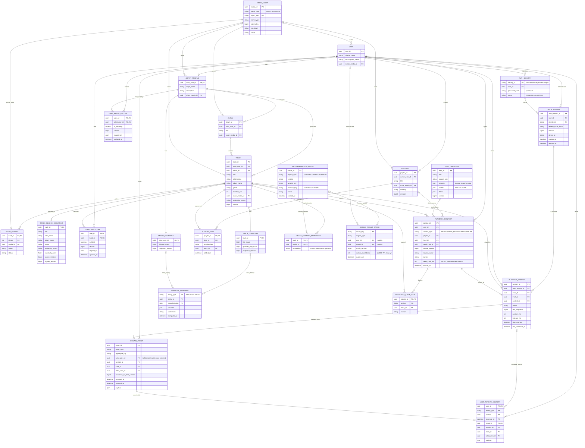
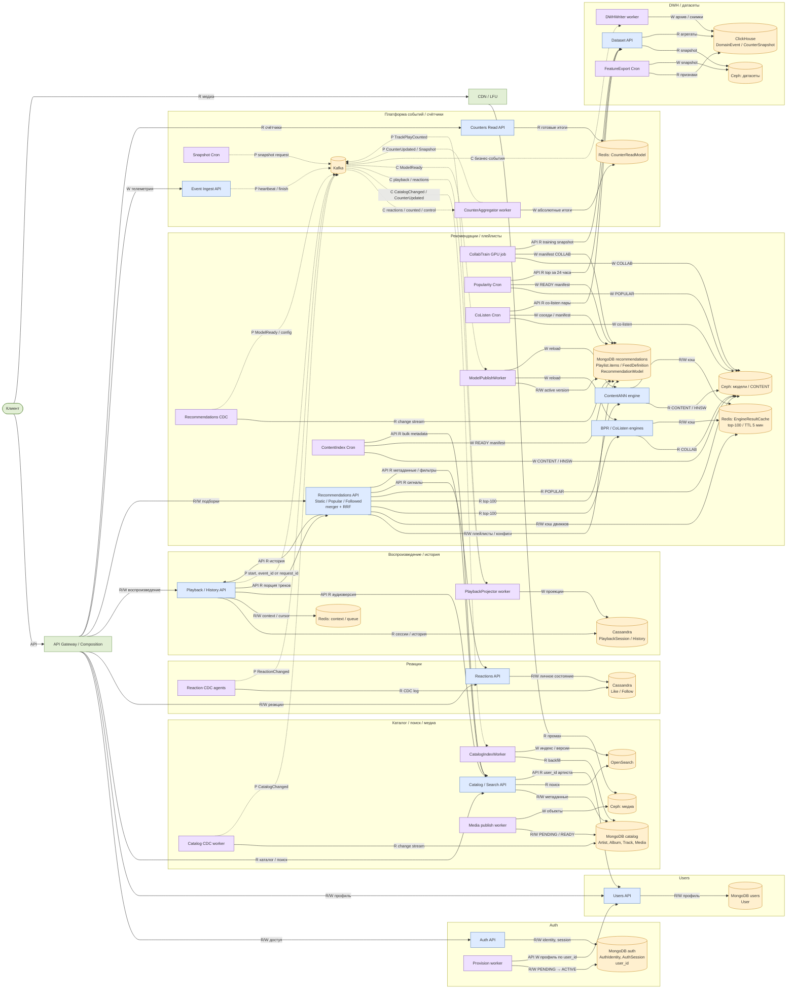

# Рассчётно-пояснительная записка для Курсовой работы по предмету "Проектирование высоконагруженных систем"

## 1. Тема и целевая аудитория

**Тип сервиса**: Музыкальный стриминг (аналог Яндекс.Музыка)

**Основной функционал MVP**: 
1) Регистрация/авторизация пользователя;
1) Возможность прослушивания треков;
1) Рекомендательная система для подбора треков по предпочтениям пользователя;
2) Поиск музыки;
4) Плейлисты: пользовательские и редакторские подборки, персональные/жанровые ленты, похожие треки;
5) Лайки треков и подписки на артистов.

**Ключевые продуктовые решения**: 
1) Поиск сразу по исполнителю и названию;
2) Рекомендательная система объединяет кандидатов нескольких движков по запросу; результаты движков кратковременно кэшируются.

**Ключевые функции, характеризующие сервис**: 
1) Прослушивание музыки;
2) Рекомендации музыки.

**Целевая аудитория**: ~30.5 млн человек в месяц. Основная часть аудитории сосредоточена в России (~95%) и Беларуси (~1.5%), остальные – другие страны СНГ. [^1]

## 2. Расчет нагрузки

### Продуктовые метрики


|Тип метрики | Величина|
|:--|:--|
|MAU | 30.5 млн.|
|DAU| 15-16 млн. (30.5 * 0.5) |

Коэффициент для DAU получен исходя из того, что в среднем Яндекс Плюс пользуются 21 день в месяц [^2], то есть коэффициент 21 / 30 = 0.7. С учетом того, что Яндекс Плюс использует больше людей, немного уменьшим коэффициент для Яндекс.Музыки.

Далее для всех расчетов будем использовать DAU = 15,5 млн.

**Среднее количество действий DAU-пользователя в день, по типам**

Типы действий выбраны исходя из MVP. Запросы heartbeat/finish считаются отдельно от сознательных действий пользователя; реакции входят в общий бюджет операций с плейлистами и реакциями.

|Тип действия | Количество в день на пользователя|
|:--|:--|
|Воспроизведение трека| ~ 12|
|Запрос рекомендаций| ~ 3|
|Поисковый запрос| ~ 1,5|
|Действие с плейлистом или реакция (лайк/подписка)| ~ 1 суммарно|
|Авторизация / обновление сессии| ~ 3|

Расчет количества прослушанных треков: по данным исследования РОМИР, 78% пользователей музыкальных стримингов в городах России проводят с сервисом более 30 минут в день [^3]. Поскольку это пороговое, а не среднее значение, для расчета берется оценка среднего времени прослушивания 40 минут в день на DAU-пользователя. Средняя длительность трека, по данным исследования, в 2020 году (данные Spotify) составила 3 минуты 17 секунд ~ 3,3 минуты [^4]. Тогда среднее число прослушанных треков в день: 40 / 3,3 ~ 12.

Частота обращений к поиску, рекомендациям, плейлистам и авторизации принята как оценка. Три обращения к Auth в день учитывают вход/обновление при JWT на 15 минут и ~40 минутах прослушивания; чтение профиля входит в состав прикладных запросов.

### Технические метрики

**Размер хранения в разбивке по типам данных**

Оценка размера каталога: по данным Forbes.ru, по состоянию на 2023 год каталог «Яндекс Музыки» насчитывал более 76 млн треков [^5]. Официальный Transparency Report сервиса указывает, что каталог еженедельно пополняется примерно на 80 тыс. единиц лицензионного контента [^6]. Считая пополнение на 2 года (104 недели): 76 + 0,08 * 104 ~ 84,3 млн, округлим до 85 млн треков.

Для адаптивного воспроизведения сервис хранит несколько версий трека под разный битрейт — режимы «Экономичное» (HE-AAC, 64 кбит/с), «Оптимальное» (AAC, 192 кбит/с) и «Превосходное» (MP3 320 кбит/с либо FLAC) [^7]. Для расчета примем упрощенно 3 сохраняемые версии на трек: 64 / 192 / 320 кбит/с. При средней длительности трека 3,3 минуты (200 сек) [^4] размер файла на каждый битрейт: 64 кбит/с -> 1,6 МБ; 192 кбит/с -> 4,8 МБ; 320 кбит/с -> 8,0 МБ; итого ~ 14,4 МБ на трек (все версии).

Бюджет метаданных каталога — ~0,33 ТБ: Track и связанные сущности. Артефакты движков рекомендаций учитываются отдельно. Для ~14,2 млн изображений по 0,3 МБ требуется ~4,3 ТБ; дополнительные размеры и пользовательские загрузки оцениваются отдельно.

|Тип данных | Количество единиц | Размер на единицу | Итого|
|:--|:--|:--|:--|
|Аудиофайлы каталога (3 версии битрейта на трек)| 85 млн треков| 14,4 МБ| ~ 1224 ТБ (1,2 ПБ)|
|Метаданные каталога и медиассылки| 85 млн треков и связанные сущности| по разделу 5| ~0,33 ТБ|
|Оперативные пользовательские данные (состояния, элементы плейлистов, история 7 суток, очереди с TTL)| по разделу 5| бюджет с запасом на вспомогательные поля| ~4,8 ТБ до индексов и репликации|
|EngineResultCache (top-100 на движок)| до 4 движков, TTL 5 минут| компактные списки| бюджет ~0,01 ТБ|
|Артефакты RecommendationModel| BPR, co-listen, CONTENT/HNSW, популярное| две версии, Ceph| бюджет до 2 ТБ|
|Изображения| ~14,2 млн| ~0,3 МБ| ~4,3 ТБ|
|**Базовый бюджет полезных данных**| | | ~1236 ТБ; без DWH, поискового индекса, временных датасетов, индексов СУБД и репликации|


|Тип метрики | Величина|
|:--|:--|
|Оперативные данные в пересчёте на MAU|~0,16 МБ, усреднённый бюджет|
|Хранилище на 1 пользователя, оффлайн-кэш|0.25 Гб|

~0,16 МБ на MAU — бюджет состояний, элементов плейлистов, истории за 7 суток и очередей с TTL (раздел 5). DWH добавляет ~108,6 ТБ/год до сжатия и репликации. Офлайн-кэш 0,25 ГБ хранится на устройстве и в серверный бюджет не входит.

**RPS в разбивке по типам запросов**

Средний RPS = DAU × действий в день / 86 400. При треке 200 секунд и heartbeat раз в 30 секунд сверх start добавляются 6 heartbeat + 1 finish: 84 запроса на DAU в сутки. Это допущение; пропуски и повторы меняют фактическую нагрузку.

|Тип запроса | Средний RPS | Пиковый RPS|
|:--|:--|:--|
|Воспроизведение трека| ~ 2153| ~ 5382|
|Запрос рекомендаций| ~ 538| ~ 1345|
|Поиск| ~ 269| ~ 673|
|Операции с плейлистом и реакции суммарно| ~ 179| ~ 448|
|Авторизация| ~ 538| ~ 1345|
|Playback heartbeat + finish| ~15 069| ~37 674|
|**Итого API**| ~18 747| ~46 868|

Итоги вычислены до округления строк. Playback API публикует STARTED при запросе воспроизведения; EventIngest принимает heartbeat/finish.

**Сетевой трафик**

Примем распределение DAU-пользователей по качеству звука: 20% - «Экономичное» (64 кбит/с), 60% - «Оптимальное» (192 кбит/с), 20% - «Превосходное» (320 кбит/с) [^7]. Средневзвешенный битрейт потока: 0,2\*64 + 0,6\*192 + 0,2\*320 = 192 кбит/с.

Суммарное время прослушивания в сутки: DAU \* 40 мин = 15,5 млн \* 40 мин = 620 млн человеко-минут/сутки = 37,2 млрд человеко-секунд/сутки. Средняя нагрузка = 37,2\*10^9 сек \* 192 000 бит/с / 86 400 сек ~ 82,7 Гбит/с; суммарный суточный объем ~ 893 ТБ/сутки.

Прослушивание распределено по суткам неравномерно (пики в утренние/вечерние часы). Примем коэффициент пик/среднее ~ 2,5 для сервисов с выраженной суточной цикличностью (аудитория сервиса сосредоточена в РФ). Пиковая нагрузка (аудио) ~ 82,7 \* 2,5 ~ 207 Гбит/с.

Принятые payload: start ~2 КБ, рекомендации ~10 КБ, поиск ~5 КБ, прочие запросы ~1 КБ. API без heartbeat/finish даёт ~235 Мбит/с и 1,015 ТБ/сутки; heartbeat/finish добавляют ~301 Мбит/с и 1,302 ТБ/сутки. Итого ~0,54 Гбит/с и 2,32 ТБ/сутки без полного учёта заголовков/повторов.

Для изображений принято 5 загрузок по 50 КБ на DAU в сутки: ~3,88 ТБ/сутки и ~0,9 Гбит/с в пике. Медиа идёт через CDN и в API RPS не входит.

|Тип трафика | Пиковое потребление, Гбит/с | Суммарный суточный объем, ТБ/сутки|
|:--|:--|:--|
|Аудиопоток (стриминг)| ~ 207| ~ 893|
|API, включая playback-телеметрию| ~0,54| ~2,32|
|Изображения через CDN| ~0,9| ~3,88|
|**Итого**| ~208,4| ~899,2|

### Прирост метрик

|Метрика | Сейчас | Прирост за год|
|:--|:--|:--|
|MAU| 30,5 млн| +32% (~ +9,8 млн; ~ 27 тыс./сутки)|
|DAU| 15,5 млн| +32% (~ +5,0 млн; ~ 14 тыс./сутки)|
|Каталог| 85 млн треков| +4,9% (~ +4,16 млн; ~ 11,4 тыс./сутки)|
|Аудиофайлы каталога| ~ 1224 ТБ| ~ +60 ТБ (~ 0,16 ТБ/сутки)|
|Метаданные каталога| ~0,33 ТБ| ~+0,016 ТБ при росте каталога на 4,9%|
|Пользовательские данные| ~ 4,8 ТБ| +32% (~ +1,54 ТБ; ~ 4,2 ГБ/сутки)|
|Кэш движков / артефакты моделей| до 0,01 / 2 ТБ| кэш растёт с RPS, артефакты — с моделью/каталогом|
|**Базовое полезное хранилище**| ~1236 ТБ| ~+62 ТБ/год без DWH/индексов/реплик; рост изображений и соседей условно пропорционален каталогу|
|Пиковый сетевой трафик (аудио)| ~ 207 Гбит/с| +32% (~ +66 Гбит/с)|
|Суточный объем трафика| ~899,2 ТБ/сутки| +32% (~+288 ТБ/сутки)|
|Средний API RPS| ~18 747| +32% (~+5999)|
|Пиковый API RPS| ~46 868| +32% (~+14 998)|

Прогноз: аудитория +32%/год [^1], каталог +4,16 млн треков (~4,9%). Пользовательские данные, RPS и трафик растут с аудиторией; аудиохранилище — примерно на 60 ТБ/год. Годовая скорость накопления playback-DWH вырастет со 108,6 до ~143,4 ТБ; индексы и служебные данные оцениваются отдельно.

## 3. Глобальная балансировка нагрузки

**Функциональное разбиение по доменам**

|Домен | Описание | Требования|
|:--|:--|:--|
|Auth| учётные данные, access/refresh, AuthSession| ротация и отзыв сессий|
|Users| профиль и план пользователя| независим от сценария входа|
|Catalog & Search| треки, артисты, медиа, поиск| CatalogIndexWorker обновляет индекс|
|Recommendations| плейлисты, конфиги движков, merger/ranker| генерация по запросу, короткий engine cache|
|Playback| аудиодоступ, история, context/queue| стабильные страницы очереди|
|Reactions| личные лайки и подписки| согласованное состояние + CDC|
|Event platform| приём событий, проекции счётчиков| Kafka, projector/aggregator workers|
|Analytics| DWH, исторические снимки, датасеты| асинхронная загрузка и export Cron|

Из раздела 2: пиковый аудиотрафик ~207 Гбит/с, изображения ~0,9 Гбит/с, API с heartbeat/finish ~0,54 Гбит/с. Основной объём байтов приходится на аудио, поэтому медиа раздаётся CDN, а прикладные запросы и приём событий обслуживаются core ДЦ.

**Обоснование расположения ДЦ**

Аудитория: 95% РФ, 1,5% Беларусь, ~3,5% другие страны СНГ [^1]. Внутри РФ ~70% населения живет в европейской части (25% территории), ~30% — в азиатской (Урал, Сибирь, Дальний Восток, 75% территории) [^9]. Крупнейшая точка обмена трафиком в РФ — MSK-IX (Москва), топ-5 в мире по трафику (пик 8,7 Тбит/с), с узлами в Москве и региональными площадками (Петербург, Казань, Екатеринбург и др.) [^8]. На практике Яндекс размещает основные ЦОДы кластером в 100-300 км от Москвы (Владимир, Сасово, Калуга), рядом с MSK-IX и основной массой пользователей, а не распределяет их по стране [^10].

Решение: 3 core ДЦ в Центральном федеральном округе (active-active-active, для отказоустойчивости) обслуживают прикладные API всех доменов, включая start/heartbeat/finish. Аудиобайты и изображения раздаются через CDN-узлы (Anycast) в региональных точках обмена (Москва, Петербург, Екатеринбург, Новосибирск), с пирингом в Минске и Алматы. Для небольшой доли аудитории СНГ отдельный core ДЦ в принятой модели не предусматривается.

**Расчет распределения запросов по ДЦ**

Три core ДЦ обслуживают ~18 747/46 868 среднего/пикового API RPS и ~0,54 Гбит/с. Штатно на ДЦ приходится ~6249/15 623 RPS; по N+1 каждый рассчитан на ~9374/23 434 при отказе одной площадки. Доступность хранилищ проверяется отдельно.

При допущении 90% попаданий по байтам CDN отдаёт ~186 Гбит/с, Ceph — ~21 Гбит/с. На core ДЦ приходится ~7 Гбит/с штатно и ~10,5 при отказе одного. Для изображений до измерения hit ratio резервируется дополнительно до 0,9 Гбит/с origin-трафика суммарно; API-полоса учитывается отдельно.

**Схема DNS-балансировки (GeoDNS)**

Используется для доступа к core ДЦ (auth, catalog, recs, playlists):

```
Клиент -> локальный DNS-резолвер -> авторитативный GeoDNS
       -> определяет регион резолвера и живой (health-check) ДЦ
       -> возвращает IP ближайшего/доступного core ДЦ (ДЦ-1, ДЦ-2 или ДЦ-3)
Клиент -> подключается напрямую по полученному IP
```

Слабое место — кэширование ответа на стороне резолвера/клиента (TTL): переключение при отказе ДЦ происходит не мгновенно [^11].

**Схема Anycast-балансировки**

Используется для CDN-узлов, раздающих аудиопоток: один и тот же IP-префикс анонсируется по BGP одновременно из всех точек присутствия (Москва, Петербург, Екатеринбург, Новосибирск, Минск, Алматы). DNS возвращает Anycast-адрес, а выбор площадки определяется сетевыми маршрутами и политиками BGP, а не точным географическим расстоянием [^11]. При отказе площадки её анонс должен быть отозван; переключение не ждёт истечения DNS TTL, но требует обнаружения отказа и сходимости маршрутов. Установленные соединения могут оборваться и потребовать повторного подключения.

**Механизм регулировки трафика между ДЦ**

- Core ДЦ (GeoDNS): health-check каждые N секунд; при отказе ДЦ его IP исключается из ответов, TTL записи снижен (например, до 30-60 сек) для быстрого переключения.
- Плановое перераспределение нагрузки (релизы, обслуживание) — постепенный перевод DNS-ответов/BGP-анонсов, а не резкое переключение.

## 4. Локальная балансировка нагрузки

App-серверы доменов — stateless (масштабируются балансировкой), БД — stateful; схема чтения и записи зависит от СУБД (раздел 6). App-слой разворачиваем в Kubernetes: отдельно устанавливаем **NGINX Ingress Controller** (проект nginx/kubernetes-ingress, вариант с NGINX Open Source [^19]) для L7. Для Kubernetes Service **kube-proxy** настраивает L4-правила в ядре; выбран режим nftables на совместимых Linux-узлах [^20].

**Уровни и резервирование**

```
Клиент -> L4-правила входного Service (kube-proxy/nftables) -> L7 (NGINX Ingress Controller, TLS termination, роутинг)
       -> App-под домена -> межсервисные вызовы (sidecar proxy) -> нужная СУБД (раздел 6)
```

Здесь выбран вход через Service ingress-controller. Контроллер направляет запросы к pod-адресам нужного сервиса; повторный проход через ClusterIP app-сервиса не обязателен. kube-proxy программирует правила, а не выступает отдельным последовательным HTTP-прокси.

|Уровень | Формула | Что переживает|
|:--|:--|:--|
|L4 / L7 / App-под / read-реплика (внутри ДЦ)| N+1| отказ одного узла|
|3 core ДЦ (раздел 3, между ДЦ)| N+1 на уровне ДЦ| отказ одного ДЦ целиком|

N+1 — минимум под нагрузку плюс один запасной элемент. "Элемент" может быть и отдельной машиной (внутри ДЦ), и целым ДЦ (между ДЦ) — формула та же, просто единица резервирования другая. При 3 ДЦ: под пиковую нагрузку в сумме нужно 2 ДЦ-эквивалента (каждый provisioned на 50% пика), третий — запасной; любые 2 из 3 вместе вытягивают 100%. Суммарно провижинится ~150% пиковой мощности — дешевле, чем N x 2 (две полностью независимые копии по 100% каждая, то есть 200%, или 300% для трех копий).

Отдельно стоит отметить: с ровно 2 ДЦ формулы N+1 и N x 2 физически совпадают — если нужна гарантия "1 из 2 ДЦ один вытянет всё", этот один ДЦ по-любому должен быть provisioned на 100%, другого способа нет. Разница между формулами становится ощутимой только от 3 единиц резервирования и больше — именно поэтому переход на 3 ДЦ даёт реальную экономию (150% вместо 200%), а не просто "на всякий случай".

**L3/L4: выбор способа (LVS/IPVS) — отдельный балансировщик перед edge/CDN**

Это не kube-proxy (он только для core ДЦ, см. выше) — для раздачи аудио стоит отдельный, специально настроенный LVS/IPVS-балансировщик вне Kubernetes, и вот для него способ выбирался осознанно:

|Способ | Ответ сервера | Нагрузка на LB|
|:--|:--|:--|
|NAT| идёт обратно через LB| высокая|
|IP Tunneling | идёт клиенту напрямую| только входящий трафик, но есть накладные расходы на инкапсуляцию/декапсуляцию на каждый пакет|
|Direct Routing (DR, меняется MAC, не IP)| идёт клиенту напрямую| LB обрабатывает входящие пакеты, объёмный ответ обходит его|

Берём DR: при ~207,9 Гбит/с полного исходящего медиатрафика важно, чтобы ответ обходил LB. Входящие пакеты всё равно требуют CPU и пропускной способности; пределы по PPS/CPS и сеть проверяются отдельно. Серверы и балансировщик каждой CDN-площадки размещаются в общей L2-сети. Для API в core ДЦ (~0,54 Гбит/с) используются правила Service kube-proxy/nftables, отдельный DR-балансировщик не нужен. Для выделенного LVS-балансировщика keepalived выполняет проверки и VRRP-переключение виртуального IP на резервный узел.

**Входящие запросы (L7)**: настраиваем least connections (least_conn), поскольку время обработки поисковых запросов различается. Число активных соединений — приближение занятости, а не точная загрузка сервера; преимущество перед round-robin проверяется на целевом профиле нагрузки. Разбор случайной маршрутизации [^12] иллюстрирует риск очередей, но сам по себе не доказывает превосходство алгоритма для нашего сервиса.

**Межсервисные запросы**: sidecar proxy на стороне вызывающего сервиса получает адреса готовых экземпляров через discovery (например, headless Service с DNS-именем в CoreDNS) и применяет настроенную балансировку без возврата к внешнему Ingress. CoreDNS разрешает имена; готовность pod определяется проверками Kubernetes, а оценка занятости — политикой прокси.

**Схема отказоустойчивости**

|Что отказало | Кто обнаруживает | Что происходит|
|:--|:--|:--|
|L4/L7/app-узел| health-check| узел исключается, N+1 покрывает|
|Read-реплика БД| health-check| чтение уходит на оставшиеся (N+1)|
|Весь core ДЦ| внешние health-check, обновление GeoDNS (раздел 3)| оставшиеся 2 из 3 ДЦ принимают по 50% пика (N+1); переключение зависит от DNS-кэшей и доступности реплик данных|
|CDN-сервер / вся edge-площадка| локальные проверки / отзыв BGP-анонса| сервер исключается локально; при потере площадки маршруты сходятся к другой, клиенту может потребоваться повторное подключение|

**Расчет количества балансировщиков**

У API и медиа разные профили нагрузки. Для API, включая playback-телеметрию, проверяются обработка запросов и TLS; стоимость handshakes существенна при частом создании соединений. Медиа передаёт большой объём байтов по длительным соединениям, поэтому важна пропускная способность сети. При повторном использовании HTTPS-соединения новый handshake не требуется для каждого сегмента или heartbeat.

*API-слой.* Ориентир бенчмарков [^16][^17] — ~10 000 новых HTTPS-соединений/с на узел. При 23 434 RPS на ДЦ и одном новом соединении на запрос: ceil(23 434 / 10 000) = 3 рабочих узла, с N+1 — 4 на ДЦ, 12 суммарно. Keep-alive/resumption [^18] снижают CPS; оценка проверяется на целевой конфигурации.

*Edge/CDN-слой, ограничитель — пропускная способность сети.* CDN передаёт весь медиатрафик, включая промахи кэша: 207 Гбит/с аудио + 0,9 Гбит/с изображений. При целевой полезной полосе 10 Гбит/с на узел нужно ceil(207,9 / 10) = 21 рабочий сервер. Четыре точки присутствия — Москва, Петербург, Екатеринбург, Новосибирск; добавляем по одному резервному узлу на точку: 21 + 4 = 25 серверов (10/7/4/4). Балансировщики и внешние каналы считаются отдельно в разделе 11; 90% cache hit снижает origin-трафик, но не исходящий трафик CDN.

*Вывод.* API требует 12 Ingress-экземпляров на разных workers (раздел 11), CDN — 25 кэш-серверов. Числа проверяются испытаниями полного медиатрафика и распределения нагрузки по площадкам.

## 5. Логическая схема БД

Auth хранит доступ и сессии, Users — профиль. Онлайн-состояния отделены от DWH DomainEvent. FK на схеме — логические ссылки между доменами, а не межбазовые ограничения.



AuthSession связана с User по user_id и отличается от PlaybackSession. Access JWT — 15 минут, refresh-сессия — до 30 суток; ротация refresh по version, logout отзывает сессию. TTL очищает документы, но срок/отзыв проверяет Auth API; уже выданный JWT действует до истечения [^42].

PlaylistItem физически вложены в Playlist.items: до 10 000 элементов; изменение массива и revision атомарно. Разрешены намеренные повторы трека. Очередь до 200 треков и её контекст принадлежат Playback, EngineResultCache — только восстанавливаемый кэш движков.

### 5.1. События и DWH

|Тип события | Основные данные | Назначение|
|:--|:--|:--|
|PLAYBACK_STARTED| session_id, auth_session_id, track_id, context_id| начало воспроизведения|
|PLAYBACK_HEARTBEAT / FINISHED| session_id, sequence, listened_ms, position_ms| прогресс / завершение|
|TRACK_PLAY_COUNTED| event_id, session_id, track_id| один факт прослушивания после min(30 сек, длительность), без перемотки|
|TRACK_LIKE_CHANGED / ARTIST_FOLLOW_CHANGED| user_id, объект, состояние, version| реакции|
|COUNTER_UPDATED / COUNTER_SNAPSHOT| объект, абсолютные значения, version/watermark| онлайн-проекции и исторические снимки|
|CATALOG_CHANGED / MODEL_READY| объект/модель, version| поиск / публикация артефактов|

DomainEvent — общий конверт; бизнес-события архивируются в DWH. Контрольные события MODEL_READY не включены в оценку playback-архива.

### 5.2. Объёмы и нагрузка

Полезные данные — до индексов и репликации; 80 байт на состояние реакции / элемент плейлиста.

|Сущности | Основание | Объём|
|:--|:--|:--|
|User / ArtistProfile / Album| 30,5 млн / 5,7 млн / 8,5 млн| ~30 / 2,3 / 3,4 ГБ|
|AuthIdentity / AuthSession| 30,5 млн × 512 байт / до 2 сессий на MAU × 256 байт| ~15,6 / 15,6 ГБ|
|Track| 85 млн × 2 КБ| ~0,17 ТБ|
|MediaAsset / AudioVariant| 269,2 млн × 256 байт / 255 млн × 128 байт| ~68,9 / 32,6 ГБ|
|Аудио / изображения| три аудиокачества / 14,2 млн изображений| ~1224 / 4,3 ТБ|
|TrackSearchDocument| до 85 млн документов| проектный индекс до 1 ТБ|
|UserTrackLike / UserArtistFollow| 250 лайков / 10 подписок на MAU| ~0,61 ТБ / 24,4 ГБ|
|Playlist с items| 10 плейлистов на MAU, по 50 элементов| ~61 ГБ метаданных + 1,22 ТБ элементов|
|UserActivityHistory| playback × 7 суток × 200 байт| ~2,08 ТБ плюс реакции|
|PlaybackContext / QueueItem| до 2 на DAU, 200 × 32 байта + до 100 seen ID, TTL 24 часа| до ~0,25 ТБ плюс метаданные|
|EngineResultCache| 1345 RPS × 300 сек × до 4 движков × 100 × 20 байт| до ~3,23 ГБ сырого payload; бюджет 10 ГБ|
|RecommendationModel и артефакты| BPR-факторы, co-listen top-50, content-векторы/HNSW, популярное; две версии| бюджет до 2 ТБ в Ceph|
|TrackContentEmbedding| 85 млн × 128 × 4 байта; внутри артефактов CONTENT| ~43,5 ГБ на версию; запас до 2 КБ/трек|
|DomainEvent, DWH| 186 млн воспроизведений/сутки × 8 событий × 200 байт| ~108,6 ТБ/год плюс производные события и реакции|
|TrackCounters / ArtistCounters / CounterSnapshot| агрегаты / ежедневные снимки| зависят от активности и срока хранения|

## 6. Физическая схема БД

PostgreSQL исключён: основные операции выполняются по ключу/документу, междоменные JOIN/FK не используются. Конфиг FeedDefinition и плейлист с items — документы MongoDB; revision проверяется в условии атомарного обновления [^43]. БД auth/users/catalog/recommendations имеют отдельных владельцев и учётные данные; общий физический кластер — компромисс стоимости, доступа к чужим коллекциям нет [^44].

|Данные / владелец | Размещение и шардирование | Индексы / согласованность|
|:--|:--|:--|
|AuthIdentity / Auth| MongoDB auth: hashed _id=нормализованный provider:subject или local:email| уникальность _id; user_id; majority+journal|
|AuthSession / Auth| MongoDB auth: hashed _id=auth_session_id| user_id; TTL expires_at; CAS version для refresh; API проверяет expires_at/revoked_at|
|User / Users| MongoDB users: hashed _id=user_id| чтение по ID; majority+journal|
|ArtistProfile / Album / Track / MediaAsset / Catalog| MongoDB catalog: hashed _id сущности; AudioVariant вложены в Track.variants| artist_user_id, album_id; уникальный bitrate внутри трека проверяется атомарным обновлением|
|Playlist / FeedDefinition / RecommendationModel / Recommendations| MongoDB recommendations: hashed _id=playlist_id/feed_id/model_id| owner_user_id; items и revision в одном документе; артефакты по object_key в собственном Ceph-бакете|
|TrackSearchDocument / Catalog| OpenSearch: 12 primary shards, routing=hash(track_id), 2 replica каждого| zone awareness по трём ДЦ; API только читает, CatalogIndexWorker пишет; версии metadata/signals отдельно|
|UserTrackLike / UserArtistFollow / Reactions| Cassandra: token ring, partition=user_id; clustering=track_id/artist_user_id| RF=3 по ДЦ, QUORUM; изменения через LWT/SERIAL; version/request_id [^28]|
|PlaybackSession / Playback| Cassandra: partition=session_id| RF=3, QUORUM; sequence; TTL 7 суток|
|UserActivityHistory / Playback| Cassandra: partition=(user_id,event_type,day), clustering=(occurred_at,event_id)| дневные партиции, TTL 7 суток; запись только projector worker|
|PlaybackContext / QueueItem / Playback| Redis Cluster: hash tag {context_id}, ordinal| страница + cursor атомарны в одном slot; TTL 24 часа; утрата → новый контекст|
|EngineResultCache / Recommendations| Redis Cluster: hash(engine,config/model version,user/seed,filters,signals_version,source_revision,source_cursor,exclude_hash)| до 100 кандидатов/ключ; TTL 5 минут, cache-aside; это не база готовых рекомендаций|
|TrackCounters / ArtistCounters / Event platform| Redis Cluster: ключ entity_type:entity_id:bucket; hot-объекты — до 16 buckets в разных slots| CounterAggregatorWorker читает Kafka; материализованный итог обновляется раз в секунду; read API не считает события|
|DomainEvent / Event platform + DWH| Kafka: ключ агрегата; playback.raw — 192 partitions, reactions/counted — по 96; ClickHouse: hash(aggregate_key) % 3, PARTITION BY toYYYYMM(occurred_at)| RF=3, minISR=2, acks=all; Kafka 7 суток; DWH 1 год, ORDER BY(event_type,toDate(occurred_at),aggregate_key,event_id)|
|CounterSnapshot / Analytics| ClickHouse: hash(entity_id) % 3, PARTITION BY месяц snapshot_date| ORDER BY(type,id,date); watermark; 3 реплики шарда|
|TrackContentEmbedding / Recommendations| Parquet по hash(track_id) % 64 и model_version в Ceph; HNSW в RAM движка| отдельная CONTENT-модель, BPR-факторы в другом артефакте|
|Аудио / изображения / Catalog| Ceph: object_key → CRUSH, 12 OSD-хостов| size=3, min_size=2; копии в разных ДЦ; CDN LFU|

MongoDB: **2 шарда × 3 реплики** (по копии каждого шарда в ДЦ), 3 config server всего и 2 mongos на ДЦ; majority-записи и выборы primary [^30], chunks распределяются balancer по hashed-ключам [^43]. UUID/_id lookup таргетируется; выборки по артисту/владельцу используют индексы, при отсутствии shard key обращаются к двум шардам.

Cassandra — 9 узлов, token-aware routing, NetworkTopologyStrategy: по одной копии в каждом ДЦ (всего RF=3). Redis — 6 primary + 6 replica с anti-affinity между ДЦ; собственные префиксы/ACL у Playback, Recommendations и платформы событий. ClickHouse — 3 шарда × 3 реплики. Шардирование делит данные, репликация создаёт копии; реплики одного набора не совмещаются на одном хосте.

CDC-агенты владельцев публикуют изменения в Kafka с checkpoint; event_id воспроизводим из ключа агрегата и version. Playback API подтверждает STARTED в Kafka перед выдачей аудиоссылки; EventIngest принимает heartbeat/finish. PlaybackProjector формирует сессии/историю и TRACK_PLAY_COUNTED; CounterAggregator считает реакции/прослушивания **только из Kafka**, поддерживает changelog и публикует абсолютные COUNTER_UPDATED. DWHWriter архивирует, Snapshot Cron запрашивает снимок по watermark. Повторное событие не должно повторно менять результат [^27].

## 7. Алгоритмы

### 7.1. Генерация рекомендаций

**Офлайн — независимые артефакты:**

1. FeatureExport Cron готовит из DWH положительные взаимодействия: засчитанные прослушивания/лайки; накопленный listened_ms из heartbeat не суммируется повторно.
2. CollabTrain Job обучает **BPR-MF, 128 FP32** на GPU: для тройки (user, positive, negative) повышает разность u·v_positive − u·v_negative; SGD с разреженными градиентами [^45]. Результат — пользовательские/трековые факторы COLLAB. CoListen Cron отдельно строит top-50 по совместным прослушиваниям последних 20 треков пользователя; COLLAB-версия готова только после обоих артефактов.
3. ContentIndex Cron отдельно строит **TF-IDF по метаданным/жанрам → TruncatedSVD(128) → нормализация → HNSW cosine**. SVD обучается на выборке, каталог преобразуется батчами; это TrackContentEmbedding, а не факторы BPR [^46].
4. Popularity Cron готовит top по жанру/общему каталогу за 24 часа. Версионные артефакты пишутся в Ceph, MODEL_READY обрабатывает ModelPublishWorker; движки загружаются по ДЦ с fallback при обновлении. Готовые персональные списки на всех пользователей не сохраняются.

**Движки вызываются при запросе**, каждый возвращает до 100 упорядоченных кандидатов:

|Движок | Генерация кандидатов|
|:--|:--|
|BPR| до 1000 co-listen соседей последних 20 положительных треков + до 1000 популярных; вычислить r_cf(t)=u·v_t только на этом пуле, выбрать top-100; без ANN и полного сканирования каталога|
|CoListen| top соседей seed-трека по совместным прослушиваниям|
|ContentANN| HNSW по контентному вектору seed / до 5 недавних положительных треков|
|Popular| актуальный жанровый/общий top|
|FollowedArtists| новые треки подписанных артистов через Reactions/Catalog API|
|StaticPlaylist| следующая часть Playlist.items по порядку и revision|

FeedDefinition хранит состав движков, их лимиты/веса, фильтры и ranker:

|Запрос | Движки / веса | Итоговое ранжирование|
|:--|:--|:--|
|STATIC_PLAYLIST| StaticPlaylist| NONE, сохраняется порядок|
|PERSONALIZED| BPR:3, ContentANN:2, FollowedArtists:1, Popular:1| weighted RRF|
|GENRE| BPR:2, ContentANN:1, Popular:2; genre обязателен| weighted RRF|
|TRENDING| Popular| порядок популярности|
|SIMILAR| ContentANN:3, CoListen:2, Popular:1| weighted RRF|
|TRACK| выбранный трек; продолжение отдельным SIMILAR-запросом| NONE|

**Онлайн-конвейер:**

1. Recommendations API выбирает FeedDefinition и получает личные сигналы через History/Reactions API. На промахе EngineResultCache запускает движки; ключ содержит версии модели/конфига/сигналов, source revision/cursor, seed, фильтры и hash исключённых ID, TTL 5 минут.
2. Для динамических лент Merger объединяет списки и удаляет дубли по track_id; Catalog API проверяет доступность/жанр, исключаются уже выданные/стоящие в очереди треки. STATIC идёт по item_id/source_cursor: намеренные повторы track_id сохраняются.
3. **Только затем ranker** вычисляет Score(t)=Σ w_engine/(60+rank_engine(t)), отсутствующий трек даёт 0 [^47]. Это финальное ранжирование общего пула, а r_cf внутри BPR — отбор кандидатов одним движком. Для STATIC/TRACK RRF отключён.
4. Выбрать до 20 треков; в динамических лентах — не более двух подряд одного артиста. При нехватке — Popular с нужными фильтрами, затем конец. Для STATIC сохраняется порядок доступных элементов.
5. Playback API получает результат и атомарно дополняет **свою** очередь до 200 элементов вместе с cursor. Повтор cursor возвращает материализованную страницу. При изменении revision статичного плейлиста контекст обновляется; динамическая следующая порция может использовать свежую модель.

Личные сигналы обновляются после обработки событий онлайн-проекцией, без ожидания обучения BPR. EngineResultCache можно удалить и пересчитать; модель/конфиг — постоянные данные, очередь — состояние воспроизведения.

### 7.2. Вытеснение кэша CDN

**Алгоритм**: LFU по частоте обращений за последние 24 часа. Он удерживает актуальные хиты и постепенно забывает старую популярность.

1. Ключ объекта — track_id + битрейт; при запросе обновляется частота.
2. При промахе файл получается из Ceph, отдаётся клиенту и кэшируется.
3. При нехватке места удаляются наименее частые объекты; при равенстве — давно не использованные.
4. Устаревшие обращения исключаются из статистики окна.

**Структуры**: хэш-таблица объектов, счётчики по часовым корзинам и min-heap кандидатов на удаление. Цена решения — память статистики и обновление приоритетов.

**Альтернативы**: LRU учитывает давность, FIFO — порядок добавления; предиктивный прогрев требует прогноза спроса. LFU выбран из-за перекоса к популярным трекам. Доля попаданий 90% по байтам остаётся допущением: её проверяют на трассе запросов и при необходимости пересчитывают origin-полосу.

## 8. Технологии

Выбор технологий сводится к задачам ниже; расчётные мощности проверяются испытаниями.

|Категория | Технология | Назначение | Альтернативы | Обоснование|
|:--|:--|:--|:--|:--|
|Оркестрация и деплой|Kubernetes|stateless app-слой|VM / Docker Compose|размещение, перезапуск и масштабирование pod; ingress устанавливается отдельно|
|Оркестрация и деплой|GitLab CI + ArgoCD|CI/CD в трёх ДЦ|ручной kubectl apply|сборка/проверки и воспроизводимая доставка конфигурации из Git|
|Виртуализация|KVM / libvirt|два MongoDB-шарда либо Kafka/OpenSearch на общем хосте|отдельные bare-metal узлы|выделенные vCPU/RAM и диски; реплики одного шарда на разных хостах [^39]|
|Обучение|PyTorch / TorchRec / CUDA|BPR-MF на GPU|CPU-обучение|128-компонентные факторы COLLAB; SGD и шардирование [^37][^45]|
|Балансировка и сеть|NGINX Ingress Controller (nginx/kubernetes-ingress, OSS)|входящий HTTP(S)|Traefik / HAProxy|TLS, маршрутизация, least_conn; выбран поддерживаемый проект NGINX [^19]|
|Балансировка и сеть|kube-proxy, nftables|Kubernetes Service|iptables / eBPF-CNI|L4-правила на совместимых Linux-узлах; IPVS-режим kube-proxy устарел [^20]|
|Балансировка и сеть|LVS/IPVS DR + keepalived|балансировка CDN-площадки|NAT / Tunneling|ответ обходит LB; общая L2-сеть, VRRP-переключение VIP|
|Балансировка и сеть|GeoDNS|выбор core ДЦ|Anycast|простота для трёх площадок; переключение ограничено DNS TTL|
|Балансировка и сеть|Anycast/BGP|выбор CDN-площадки|GeoDNS|смена маршрута без DNS TTL; остаётся задержка сходимости BGP|
|Балансировка и сеть|Sidecar proxy (Envoy)|межсервисные вызовы|клиентская балансировка|общие политики тайм-аутов/балансировки; требует discovery адресов экземпляров|
|Балансировка и сеть|CoreDNS|DNS-имена сервисов|Consul|использует сведения Kubernetes; загрузку pod не измеряет|
|Хранилища|MongoDB|Auth, Users, Catalog, конфиги/плейлисты Recommendations|PostgreSQL|2 шарда; отдельные БД доменов; атомарные документы Playlist.items/revision [^43]|
|Поиск|OpenSearch|TrackSearchDocument|индекс MongoDB / Elasticsearch|текстовый индекс, жанровые фильтры; перестраивается из каталога [^29]|
|Хранилища|Cassandra + CDC-потребитель|лайки, подписки, сессии, история|PostgreSQL / распределённый KV-store|доступ по пользовательским ключам; LWT/QUORUM для реакций, TTL истории [^28]|
|Хранилища|Redis Cluster|кэш движков, Playback context/queue, проекции счётчиков|MongoDB|разные ACL/префиксы; TTL, hash slots, атомарные страницы [^26]|
|Хранилища|Kafka|события и changelog|прямая запись в проекции|входные события хранятся 7 суток; changelog состояния — compact; порядок по агрегату и replay [^27]|
|Обработка событий|Kafka Streams|дедупликация и проекции|Flink / собственные потребители|состояние с changelog; внешние проекции записываются идемпотентно [^27]|
|Хранилища|ClickHouse|DomainEvent, CounterSnapshot, датасеты|batch-движок|колоночные чтения, 3 шарда × 3 реплики|
|Хранилища|ClickHouse Keeper|координация реплик|ZooKeeper|компонент экосистемы ClickHouse; требуется отказоустойчивый кворум [^21]|
|Хранилища|Ceph RGW|аудио и изображения|managed S3|контроль размещения/репликации, S3 API; самостоятельная эксплуатация|
|Кэширование|собственный HTTP-кэш на NVMe, LFU с окном|CDN|Varnish LRU / NGINX proxy_cache|частота удерживает хиты; LFU реализуется отдельно, штатный Varnish использует LRU [^22]|
|Рекомендации|TF-IDF / TruncatedSVD / HNSW|отдельный ContentANN engine|Annoy / точный cosine|контентные признаки независимо от BPR; онлайн top-100 [^23][^46]|
|Доступ|OAuth 2.0 / OIDC, JWT + refresh-сессии|Auth API; профиль отдельно в Users|серверные access-сессии|JWT 15 мин, AuthSession до 30 дней; отзыв refresh и проверка срока [^24][^42]|
|Эксплуатация|Prometheus + Grafana + Alertmanager|метрики и оповещения|Zabbix|сбор, визуализация и доставка тревог; failover выполняют сами компоненты [^25]|
|Эксплуатация|ELK/EFK или Loki|централизованные логи|Graylog / OpenSearch|единый поиск ошибок по сервисам и ДЦ|
|Тестирование|Yandex.Tank / k6 / Gatling|нагрузочные испытания|собственный генератор|воспроизводимые RPS/CPS, p95/p99 и доля ошибок|
|Тестирование|Chaos Mesh|эксперименты со сбоями|собственные сценарии|проверка pod/узлов/сети; отказ ДЦ требует отдельных сценариев|

## 9. Обеспечение надёжности

Резервирование, репликация и переключение описаны в разделах 3, 4, 6 и 11. Ниже — дополнительные механизмы обработки сбоев.

### 9.1. Асинхронные потоки и повторы

|Паттерн / поток | Обработка сбоя|
|:--|:--|
|CDC: реакции, каталог, конфиги| checkpoint сохраняется после ack Kafka. При выходе за окно CDC/oplog — переснимок и сверка; потерянная история изменений из текущего состояния не восстанавливается|
|Backpressure: события плеера| ограниченные буферы и 429/503 при перегрузке; клиент повторяет прежний event_id с backoff/jitter|
|Idempotent Consumer: история, счётчики| exactly_once_v2 фиксирует offset, состояние и выходные события внутри Kafka. Внешние приёмники подтверждают позиции после идемпотентной записи; транзакции Kafka–БД нет [^48]|
|Replay: онлайн-проекции| восстановление из changelog/снимка с watermark и хвоста Kafka. Старый архив пересчитывается в отдельную проекцию, чтобы повторно не увеличить действующие счётчики|
|Идемпотентный приёмник: DWH| offset подтверждается после insert_quorum=2. Повтор сохраняет event_id; датасеты и агрегаты читаются с дедупликацией по ID [^49]|
|Saga / checkpoint: медиа и фоновые Job| шаги и попытки сохраняются; повтор продолжает незавершённый шаг. При отмене удаляются незавершённые объекты; Cron не допускает параллельную обработку одной версии|

### 9.2. Цели и проверка восстановления

Проектные цели, **не результаты испытаний**: для API воспроизведения/рекомендаций — 99,9% технически успешных ответов за 3 с за 30 дней, p95 ≤500 мс; для счётчиков — 99% событий применены за 60 с.

|Сценарий | Сохранность / цель|
|:--|:--|
|Один core ДЦ| RPO=0 для подтверждённых majority/QUORUM записей MongoDB/Cassandra и ack Kafka при исправных оставшихся копиях. RTO API ≤120 с для контрольных клиентов; Kafka/Streams ≤5 мин [^51]|
|Один API/Ingress-узел| цель переключения ≤30 с. Redis не даёт RPO=0; возможен сброс контекста [^26]|
|Порча данных / потеря журнала| backup → сверка версий/offsets → доступный хвост журнала. Без непрерывного журнала RPO ограничен последней восстановимой точкой|

Ежеквартально проверяются отказ узла/ДЦ, остановка consumer, повтор пачки и восстановление backup. Передача ~1228 ТБ медиа по каналу 10 Гбит/с занимает минимум ~11,4 суток; полный RTO определяется пробным восстановлением.

## 10. Схема проекта

Домены владеют своими данными; фоновые worker/job/cron выделены отдельно. R — чтение, W — запись/команда, P/C — публикация/чтение событий. Пунктир — Kafka; мягкие линии и подписи заменяют угловатые связи.



Синие узлы — API/онлайн-движки, фиолетовые — фоновые процессы, жёлтые — данные. Единственный писатель OpenSearch — CatalogIndexWorker. Счётчики строятся из Kafka; фронт читает готовую проекцию. Provision worker создаёт профиль по user_id перед активацией AuthIdentity.

MongoDB-блоки — разные БД/ACL на общем шардированном кластере; Redis-блоки — разные префиксы/ACL; Ceph — отдельные бакеты владельцев. Совместные физические хосты из раздела 11 не дают сервисам доступа к чужим данным. Междоменные ссылки разрешаются через API или события.


## 11. Список серверов

Расчёт по [лекции 11](https://github.com/init/highload/blob/main/highload_l11_hosting.md): аренда bare-metal; приложения и Ingress совместно в Kubernetes, часть БД — в отдельных KVM-VM на общих хостах, обучение — на GPU. База: 46 868 API RPS, 207,9 Гбит/с медиа, ~27 ПБ внешнего трафика за 30 суток. Сравнение с раздельным размещением — в 11.5.

### 11.1. Хостинг и оборудование

|Провайдер | Размещение | Причина выбора|
|:--|:--|:--|
|NETRACK| три core ДЦ: IXcellerate North, IXcellerate South, StoreData| отдельные московские площадки, аренда серверов, частные сети и BGP [^32]|
|EdgeCenter| собственный LFU-кэш в Москве, Петербурге, Екатеринбурге, Новосибирске| bare-metal в нужных регионах; управляемый CDN не используется [^33]|
|Selectel| отдельная площадка в Петербурге для бэкапов| независимость от рабочих кластеров и их учётных данных [^34]|
|HOSTKEY| GPU-пул в одном московском ДЦ, вне онлайн-контура| конфигурация класса gpu.v4-6000Pro-10g; наличие пяти узлов и private VLAN требуют КП [^37]|

Цены — **смета на 19.11.2026** с НДС. Аренда индивидуальных конфигураций и каналов требует КП; открытые предложения HOSTKEY служат ориентиром [^35]. GPU-хост класса 10g опубликован за 230 тыс. ₽/мес в предзаказе [^37]. Покупка — отдельная укрупнённая оценка полного сервера с дисками и сетевыми адаптерами, без размещения и внешней сети [^38]. Для аренды размещение, питание и замена оборудования включены в ставку; расширенная сеть — отдельно.

CPU core-серверов — физические ядра x86-64, SMT отключён; GPU-хост указан в vCPU по тарифу провайдера. RAM — ГиБ, диски — десятичные ТБ. Core-хосты распределены поровну по трём ДЦ; GPU, CDN и бэкапы указаны отдельно. В количестве учтены реплики и резерв; VM и контейнеры повторно не оплачиваются как физические серверы.

|Назначение / сервисы | CPU / RAM на сервер | Диски на сервер | Сеть | Количество | Аренда, тыс. ₽/шт·мес | Аренда, тыс. ₽/мес | Покупка, млн ₽/шт|
|:--|:--|:--|:--|--:|--:|--:|--:|
|K8s workers: API, Ingress, обработчики, RGW, эксплуатация| 64 / 256| 2×1,92 NVMe, RAID1| 2×25 Гбит/с| 18 (6/ДЦ)| 70| 1260| 1,85|
|K8s control plane / etcd| 8 / 32| 2×0,48 SSD, RAID1| 2×10 Гбит/с| 9 (3/ДЦ)| 12| 108| 0,5|
|Координаторы: MongoDB config server, Keeper, KRaft, Ceph MON/MGR, OpenSearch managers| 16 / 64| 2×0,96 SSD, RAID1| 2×10 Гбит/с| 3 (1/ДЦ)| 25| 75| 0,65|
|Общие KVM-хосты: два MongoDB-шарда| 80 / 768| 8×3,84 NVMe: отдельные RAID10 по 4 диска; 2×0,96 SSD под ОС| 2×25 Гбит/с| 3| 110| 330| 2,7|
|Cassandra| 32 / 128| 4×1,92 NVMe, JBOD| 2×25 Гбит/с| 9| 45| 405| 1,3|
|Redis: 6 primary + 6 replica| 32 / 512| 2×1,92 NVMe, RAID1| 2×25 Гбит/с| 12| 65| 780| 1,4|
|Общие KVM-хосты: Kafka broker + OpenSearch data node| 48 / 256| Kafka: 4×3,84 NVMe, JBOD; поиск: 2×3,84 NVMe, RAID1; 2×0,96 SSD под ОС| 2×25 Гбит/с| 6| 65| 390| 1,55|
|ClickHouse: 3 шарда × 3 реплики| 32 / 256| 12×16 HDD, RAID10 + 2×0,96 SSD под ОС| 2×25 Гбит/с| 9| 95| 855| 2,2|
|Ceph OSD| 32 / 128| 24×20 HDD, JBOD + 2×0,96 SSD под ОС + 2×3,84 NVMe, RAID1 под DB/WAL| 2×25 Гбит/с| 12| 125| 1500| 4|
|Rec-engine hosts: BPR/CoListen, ContentANN, CPU jobs| 64 / 512| 4×3,84 NVMe, JBOD| 2×25 Гбит/с| 3| 95| 285| 2,5|
|GPU train: 1×RTX PRO 6000 Blackwell, 96 ГБ VRAM на хост| 64 vCPU / 1024| 2×3,84 NVMe| 10 Гбит/с; private VLAN| 5 (4 рабочих + 1 резерв)| 230| 1150| 6|
|CDN: HTTP-кэш LFU| 16 / 64| 2×3,84 NVMe под кэш| 2×10 Гбит/с| 25 (10/7/4/4)| 35| 875| 0,8|
|CDN: LVS / keepalived| 16 / 32| 2×0,48 SSD, RAID1| 2×100 Гбит/с| 8 (2/площадку)| 30| 240| 0,7|
|Бэкапы: отдельный репозиторий| 16 / 128| 24×20 HDD, RAID6 + 2×0,96 SSD под ОС| 2×10 Гбит/с| 6| 100| 600| 3,5|
|**Итого**| | | | **128**| | **8853**| **237,55 всего**|

RAID защищает от отказа диска, межсерверные копии — от отказа узла/ДЦ. JBOD — отдельные диски под управлением распределённого хранилища. На каждом сервере координаторов — по одному экземпляру каждого указанного компонента, до 2 CPU / 4 ГиБ на процесс. MongoDB: два shard replica set по три VM, отдельные БД доменов; на каждом физическом хосте по одной VM каждого шарда.

**Проверка ёмкости** (не более 70% заполнения; запас на индексы и служебные данные):

|Хранилище | Доступно с учётом копий / резерва | Требуется|
|:--|:--|:--|
|Ceph| 12 × 24 × 20 × 0,7 / 3 = **1344 ТБ**| 1228,3 ТБ медиа + ~62 ТБ/год + модели до 2 ТБ и датасеты до 5 ТБ|
|MongoDB| 2 шарда × 7,68 × 0,7 = **10,75 ТБ**| Auth/Users/Catalog/плейлисты/конфиги: бюджет до 5 ТБ с индексами|
|Cassandra| 9 × 7,68 × 0,7 / 3 = **16,13 ТБ**| история, реакции, сессии: бюджет до 8 ТБ с накладными расходами|
|Redis| 6 primary × 512 × 0,7 = **2150 ГиБ**| очереди, engine cache и счётчики: бюджет до 1 ТБ с накладными расходами|
|Kafka| 6 × 15,36 × 0,7 / 3 = **21,50 ТБ**| ~2,08 ТБ событий за 7 суток + changelog и накладные расходы|
|OpenSearch| 6 × 3,84 × 0,7 / 3 = **5,38 ТБ**| проектный индекс до 1 ТБ; проверяется на 85 млн документов|
|ClickHouse| 3 шарда × 96 × 0,7 = **201,6 ТБ**| playback-DWH ~108,6 ТБ/год плюс производные события/снимки; бюджет до 180 ТБ|
|Бэкапы| 6 × 22 × 20 × 0,7 = **1848 ТБ** после RAID6| одна полная копия медиа/БД/DWH + 30 суток инкрементов, до 1600 ТБ|

### 11.2. Контейнеры и VM

Количество — **на один ДЦ штатно**, кроме суммарных значений. r/l — requests/limits на контейнер; через «/» перечислены отдельные компоненты с одинаковой аллокацией. Общие Cron и GitLab учтены в верхнем бюджете одного ДЦ.

|Контейнер | Количество | CPU r/l | RAM r/l, ГиБ | Пул|
|:--|:--|:--|:--|:--|
|Auth / Users / Reactions API| 2 / 2 / 2| 2 / 4| 4 / 8| workers|
|Catalog / Event Ingest / Recommendations API| 4 / 8 / 3| 4 / 8| 8 / 16| workers|
|Playback / History API| 2| 2 / 4| 4 / 8| workers|
|Counters Read API| 2| 2 / 4| 4 / 8| workers|
|Dataset API| 2| 1 / 2| 2 / 4| workers|
|Gateway / Composition| 3| 2 / 4| 4 / 8| workers|
|Catalog CDC / Recommendations CDC| 1 / 1| 2 / 4| 4 / 8| workers|
|Provision worker / ModelPublishWorker| 1 / 1| 1 / 2| 2 / 4| workers|
|PlaybackProjector / CounterAggregator| 2 / 2| 4 / 8| 8 / 16| workers|
|DWHWriter| 2| 4 / 8| 8 / 16| workers|
|CatalogIndexWorker| 2| 2 / 4| 4 / 8| workers|
|Media publish worker| 2| 2 / 4| 4 / 8| workers|
|mongos| 2| 2 / 4| 4 / 8| workers|
|Ceph RGW| 2| 4 / 8| 8 / 16| workers|
|Snapshot Cron| 1 всего| 2 / 4| 4 / 8| workers|
|FeatureExport Cron| 1 всего| 2 / 4| 8 / 16| workers|
|CoreDNS| 2| 0,5 / 1| 0,5 / 1| workers|
|Prometheus| 2| 2 / 4| 8 / 16| workers|
|Alertmanager| 1| 0,5 / 1| 1 / 2| workers|
|Grafana / ArgoCD| 1 / 1| 1 / 2| 2 / 4| workers|
|Loki| 1| 2 / 4| 8 / 16| workers|
|CI runner| 1| 4 / 8| 8 / 16| workers|
|GitLab / Registry| 1 всего| 4 / 8| 8 / 16| workers|
|Fluent Bit| 1/узел, 30 всего| 0,25 / 0,5| 0,5 / 1| все K8s-пулы|
|kube-proxy / CNI| по 1/узел, по 30 всего| 0,25 / 0,5| 0,25 / 0,5| все K8s-пулы|
|NGINX Ingress| 4| 8 / 12| 8 / 16| workers, разные узлы|
|Envoy у worker API / Gateway| 30| 0,25 / 0,5| 0,5 / 1| workers|
|kube-apiserver| 3| 1 / 2| 2 / 4| control plane|
|etcd Kubernetes| 3| 1 / 2| 4 / 8| control plane|
|kube-controller-manager| 3| 0,5 / 1| 1 / 2| control plane|
|kube-scheduler| 3| 0,5 / 1| 0,5 / 1| control plane|
|BPR / CoListen engine, один сервис| 1| 16 / 24| 192 / 256| Rec-engine|
|ContentANN engine| 1| 8 / 12| 96 / 128| Rec-engine|
|CoListen / Popularity / ContentIndex Cron, отдельные Job| суммарно ≤1 heavy Job/ДЦ| 16 / 20| 64 / 96| Rec-engine, CPU batch quota|
|Cassandra CDC agent, Docker на Cassandra| 1/узел, 9 всего| — / 1| — / 2| вне Kubernetes|
|BPR train, Docker / TorchRec| 4 рабочих + 1 резерв| — / 56 vCPU| — / 896| GPU-host; 1 GPU на контейнер|

На worker доступны 60 CPU / 240 ГиБ после резерва ОС/kubelet: **360 CPU / 1440 ГиБ на ДЦ**. Requests — до **203,5 CPU / 387 ГиБ**. После потери ДЦ API, projector/aggregator, DWHWriter, Indexer, media/RGW и mongos увеличиваются в 1,5 раза с округлением вверх; Envoy — до 45. CDC, Dataset API и Cron не масштабируются с внешним RPS. Итого **275,25 CPU / 530,5 ГиБ**, что помещается на 5 из 6 workers (300 CPU / 1200 ГиБ). Четыре Ingress pod — на разных узлах; CI имеет низкий приоритет.

На Rec-engine хосте BPR/CoListen + ContentANN + один CPU Job требуют 40 CPU / 352 ГиБ без системных агентов; CPU/RAM limits суммарно 56 / 480. BPR-факторы и co-listen занимают ~144 ГБ до ID-индексов: используются packed arrays/mmap, не списки Python-объектов. Квота CPU-batch допускает один тяжёлый Job на ДЦ. Обновление модели — по ДЦ без двойной загрузки большого движка, с fallback; очередь не закрепляет старую модель на 24 часа.

GPU и Cassandra CDC работают вне Kubernetes: указаны Docker limits, requests отсутствуют. На GPU — 96 ГБ VRAM отдельно от RAM; резерв подхватывает checkpoint. mongos — по два роутера на ДЦ; по одному MongoDB config server размещено на трёх координаторах.

Проектные цели на pod: Gateway 5000 RPS, Event Ingest / Playback / Counters Read — 2000, Catalog — 1000, прочие API — 500. Это допущения до испытаний с внутренними вызовами, password hashing, p95/p99 и I/O. Постоянные тома эксплуатации — Ceph; логи после семплирования до 100 ГБ/сутки, 7 суток.

VM на общих хостах; vCPU привязаны к физическим ядрам, без overcommit:

|VM / сервис | VM на ДЦ | vCPU / RAM, ГиБ на VM | Диски / изоляция|
|:--|--:|:--|:--|
|MongoDB shard A replica| 1| 32 / 256| свои 4×3,84 NVMe, RAID10|
|MongoDB shard B replica| 1| 32 / 256| свои 4×3,84 NVMe, RAID10|
|Kafka broker| 2| 16 / 64| свои 4×3,84 NVMe, JBOD|
|OpenSearch data node| 2| 16 / 128| свои 2×3,84 NVMe, RAID1|

Две MongoDB VM занимают 64 из 80 CPU и 512 из 768 ГиБ; Kafka + OpenSearch — 32 из 48 CPU и 192 из 256 ГиБ. Остаток — гипервизор и резерв. Копии одного шарда всегда на разных физических хостах/ДЦ. libvirt задаёт CPU/RAM и I/O-лимиты [^39]; после отказа общего хоста проверяются оба затронутых кластера.

### 11.3. Месячная стоимость

Каналы — отдельные **сметные лимиты**: порт сервера не гарантирует внешнюю полосу. Высокие скорости согласуются индивидуально [^36]. Учитываются ~27 ПБ/месяц внешнего трафика и до ~2,8 ПБ origin-трафика; модель без оплаты каждого ГБ фиксируется в договоре. Для обмена признаками с GPU-пулом принят бюджет до 10 ТБ/месяц; трафик распределённого обучения идёт по отдельной внутренней сети и также согласуется в КП.

|Статья | Расчёт | тыс. ₽/мес|
|:--|:--|--:|
|Серверы с размещением и питанием| таблица 11.1, включая 5 GPU-хостов| 8853|
|Внешние каналы CDN| 4 × 100 Гбит/с × 500 тыс. ₽| 2000|
|Внешние каналы core| 3 × 25 Гбит/с × 150 тыс. ₽| 450|
|Меж-ДЦ сеть| 3 связи по 2×25 Гбит/с, независимые трассы; 200 тыс. ₽/связь| 600|
|Канал бэкапов| 10 Гбит/с| 100|
|DNS, адреса, BGP и дополнительные подключения| общий бюджет| 50|
|Внутренняя сеть GPU| 5 портов 10 Гбит/с / VLAN, сметно| 100|
|**Итого инфраструктура**| | **12 153**|
|Резерв сметы 20%| 12 153 × 0,2| 2430,6|
|**Плановый месячный бюджет**| | **14 583,6 (~14,58 млн ₽)**|

Смета без зарплат, музыкальных лицензий и разовых работ. Покупка всех 128 серверов — **~237,55 млн ₽ разово**, без размещения, питания, каналов и внешнего сетевого оборудования. Для CDN учтён N+1 по узлам, потеря целой CDN-площадки в 25 серверов не заложена.

### 11.4. GPU для рекомендаций

Это расчёт **упрощённого MVP с BPR-MF**, а не полной системы Яндекс Музыки: в публичном описании её команды упомянуты GPU-кластер, тысячи CPU и нейросетевое онлайн-ранжирование [^41]. У нас движки формируют кандидатов по запросу на CPU; GPU нужны для обучения BPR.

**Память.** BPR-MF, 128 компонент FP32: (30,5 млн пользователей + 85 млн треков) × 128 × 4 = **59,14 ГБ параметров**. В одной карте 96 ГБ они помещаются, но это не доказывает достаточную скорость. Для нескольких GPU таблицы распределяются через TorchRec; 4×96 ГБ не являются одним автоматически общим буфером [^40]. Данные читаются батчами из DWH, SGD использует разреженные градиенты без momentum [^37].

**Окно обучения — проектное допущение:** ежедневно обучаем по 7 суткам прослушиваний, 3 эпохи, завершение за 8 часов. Объём — 186 млн × 7 × 3 = **3,906 млрд примеров**. Один пример — положительное взаимодействие с выбранным отрицательным; после фильтрации, семплирования или добавления реакций объём пересчитывается.

Число рабочих GPU: G = ceil(3,906 млрд / (q × 28 800 × η)), где q — скорость обработки примеров на GPU, η = 0,7 — предварительный коэффициент загрузки/масштабирования. q и η должны измеряться на выбранной модели, батче и сети:

|Предполагаемая q, примеров/с на GPU | Рабочих GPU | С резервом одного хоста|
|--:|--:|--:|
|200 000| 1| 2|
|100 000| 2| 3|
|50 000| 4| 5|
|25 000| 8| 9|

**Для сметы принят условный сценарий 4 рабочих + 1 резервный GPU-хост**, при q ≥50 тыс./с и η ≥0,7. Это требование к испытанию, не результат бенчмарка и не подтверждённый минимум. Один GPU потребовал бы q ≥193 750 примеров/с в том же окне. Кроме обучения отдельно проверяется время подготовки признаков и построения HNSW.

Каждый GPU-хост: 64 vCPU / 1024 ГиБ RAM / 1×96 ГБ GPU / 2×3,84 ТБ NVMe / 10 Гбит/с; ориентир **230 тыс. ₽/мес**, предзаказ [^37], покупка — сметно **6 млн ₽**. Аренда пяти — **1,15 млн ₽/мес**, покупка — **30 млн ₽**; внутренняя сеть — ещё 100 тыс. ₽/мес по смете. HOSTKEY должен подтвердить пять совместимых узлов на одной площадке и гарантированную внутреннюю полосу. Синхронное обучение через публичные меж-ДЦ каналы не закладывается.

TorchRec распределяет таблицы и вычисления по четырём GPU; пятый узел резервируется для перезапуска из checkpoint. Три Rec-engine узла обслуживают BPR/CoListen и ContentANN; отдельные CPU CronJob строят co-listen, CONTENT/HNSW и популярное. При сбое обучения онлайн продолжает выдачу предыдущей модели. Резерв GPU нужен для свежести модели и восстановления задач, а не для обслуживания API. Число эпох, качество, q, η, peak VRAM и восстановление в заданное окно проверяются до фиксации закупки.

### 11.5. Сравнение размещения

Приложения уже делили workers в исходном варианте. Дополнительная экономия — объединение следующих физических машин; численность и ёмкость реплик БД сохраняются:

|Объединение | Раздельно, шт. / тыс. ₽·мес | Вместе, шт. / тыс. ₽·мес | Экономия, тыс. ₽/мес|
|:--|:--|:--|--:|
|Workers + Ingress| 27×32 CPU/128 ГиБ + 12×16 CPU/64 ГиБ; **39 / 1515**| 18×64 CPU/256 ГиБ; **18 / 1260**| 255|
|Два MongoDB-шарда| 6×32 CPU/256 ГиБ; **6 / 390**| 3×80 CPU/768 ГиБ; **3 / 330**| 60|
|Kafka + OpenSearch| 6×16 CPU/64 ГиБ + 6×16 CPU/128 ГиБ; **12 / 480**| 6×48 CPU/256 ГиБ; **6 / 390**| 90|
|**Итого**| **57 / 2385**| **27 / 1980**| **405**|

Остальные группы не объединяем: для Ceph/ClickHouse важны диски и восстановление, для Redis — RAM и размещение реплик; ML отделён от онлайн-нагрузки, control plane и глобальные координаторы сохраняют отдельные узлы.

|Вариант | Физических серверов | Аренда серверов, млн ₽/мес | Сеть + аренда + резерв 20%, млн ₽/мес | Покупка серверов, млн ₽|
|:--|--:|--:|--:|--:|
|Исходный, без GPU| 153| 8,108| 13,570| 217,15|
|Раздельное размещение + 5 GPU-хостов| 158| 9,258| 15,070| 247,15|
|**Совместное размещение + 5 GPU-хостов, бюджетный сценарий**| **128**| **8,853**| **14,584**| **237,55**|

При одинаковом GPU совместное размещение уменьшает аренду на **405 тыс. ₽/мес (~4,86 млн ₽/год)**, бюджет с резервом — на **486 тыс. ₽/мес**, разовую покупку — сметно на **9,6 млн ₽**. Базовые ставки покупки для сравнения: workers 1,2; Ingress 0,7; MongoDB shard VM-хосты по 1,5; Kafka 0,9; OpenSearch 0,85 млн ₽/шт.

Экономия условна: укрупнённые хосты должны стоить не более ~84,2 тыс. ₽/мес для workers, 130 тыс. для пары MongoDB shard VM и 80 тыс. для Kafka+поиска. Цены 70/110/65 тыс. ₽ приняты для сметы и требуют КП. До переноса проверяются совместная нагрузка, p99, I/O, восстановление двух кластеров при отказе хоста и failover при потере ДЦ.

[^1]: [Аудитория «Яндекс Музыки» превысила 30,5 млн человек в месяц](https://www.sostav.ru/publication/auditoriya-yandeks-muzyki-prevysila-30-5-mln-chelovek-v-mesyats-79308.html)
[^2]: [Число подписчиков Яндекс Плюса достигло 30 миллионов](https://yandex.ru/company/news/03-07-02-2024)
[^3]: [РОМИР: 85% жителей городов России пользуются музыкальными стриминговыми сервисами](https://romir.ru/feed/romir-85-jiteley-gorodov-rossii-polzuyutsya-muzykalnymi-strimingovymi-servisami)
[^4]: [Средняя длина песен с годами сокращается](https://www.kommersant.ru/doc/5170250) (Коммерсантъ, со ссылкой на исследование UCLA)
[^5]: [Более 4000 единиц контента удалены с «Яндекс Музыки» из-за «фейков» и ЛГБТ-пропаганды](https://www.forbes.ru/forbeslife/499638-bolee-4000-edinic-kontenta-udaleny-s-andeks-muzyki-iz-za-fejkov-i-lgbt-propagandy) (Forbes.ru — цифра «более 76 млн треков», 2023)
[^6]: [Transparency Report | Яндекс Музыка](https://yandex.ru/support/music/ru/rules/transparencyreport)
[^7]: [Качество звука | Яндекс Музыка](https://yandex.ru/support/music/ru/listening/quality)
[^8]: [MSK-IX вступает в клуб «Т»](https://www.msk-ix.ru/news/129/) (официальная новость MSK-IX о пиковой нагрузке 8,7 Тбит/с и топ-5 в мире)
[^9]: [Почему 69% россиян живут в европейской части России](https://www.ixbt.com/live/travel/pochemu-69-rossiyan-zhivut-v-evropeyskoy-chasti-rossii-kotoraya-zanimaet-lish-20-territorii-strany.html) (со ссылкой на данные Росстата)
[^10]: [«Яндекс» построит новый дата-центр во Владимирской области](https://servernews.ru/1129768)
[^11]: [What is Anycast? How does Anycast Work?](https://www.cloudflare.com/learning/cdn/glossary/anycast-network/) (Cloudflare Learning Center)
[^12]: [Heroku's Ugly Secret](https://genius.com/James-somers-herokus-ugly-secret-annotated) (James Somers, разбор проблемы случайной маршрутизации запросов на Heroku)
[^16]: [Testing the Performance of NGINX and NGINX Plus Web Servers](https://blog.nginx.org/blog/testing-the-performance-of-nginx-and-nginx-plus-web-servers) (nginx, 2017, CPS для HTTPS-запросов)
[^17]: [Testing the Performance of NGINX Ingress Controller for Kubernetes](https://blog.nginx.org/blog/testing-performance-nginx-ingress-controller-kubernetes) (nginx, 2019, TPS)
[^18]: [Testing TLS Session Resumption](http://vincent.bernat.im/en/blog/2011-ssl-session-reuse-rfc5077.html) (Vincent Bernat, сбор статистики по использованию SSL session tickets через tcpdump)
[^19]: [NGINX on Kubernetes](https://kubernetes.nginx.org/) — различие поддерживаемого NGINX Ingress Controller и завершившего поддержку community ingress-nginx; [настройка балансировки](https://docs.nginx.com/nginx-ingress-controller/configuration/global-configuration/configmap-resource/).
[^20]: [Kubernetes: Virtual IPs and Service Proxies](https://kubernetes.io/docs/reference/networking/virtual-ips/) — роль kube-proxy, режим nftables и устаревание режима IPVS с версии 1.35.
[^21]: [ClickHouse Keeper](https://presentations.clickhouse.com/meetup54/keeper.pdf) — материал разработчиков о режимах запуска и координации.
[^22]: [Varnish: Configuring Varnish](https://docs.varnish-software.com/book/operations/configuring-varnish/) — штатное вытеснение LRU при нехватке места.
[^23]: [hnswlib](https://github.com/nmslib/hnswlib) — инкрементальное построение HNSW; [Annoy](https://github.com/spotify/annoy) — статический индекс после build.
[^24]: [OAuth 2.0, RFC 6749](https://www.rfc-editor.org/rfc/rfc6749), [JWT, RFC 7519](https://www.rfc-editor.org/rfc/rfc7519), [OpenID Connect Core](https://openid.net/specs/openid-connect-core-1_0.html) — разграничение авторизации, формата токена и аутентификации.
[^25]: [Prometheus: Overview](https://prometheus.io/docs/introduction/overview/) — сбор метрик, визуализация и обработка оповещений.
[^26]: [Redis Cluster](https://redis.io/docs/latest/operate/oss_and_stack/reference/cluster-spec/) — hash slots, репликация, failover; отдельные логические БД Redis Cluster не поддерживает.

[^27]: [Apache Kafka: Design](https://kafka.apache.org/design/) — порядок в партициях, транзакции и границы exactly-once при работе с внешними хранилищами.
[^28]: [Apache Cassandra: Change Data Capture](https://cassandra.apache.org/doc/stable/cassandra/managing/operating/cdc.html) — чтение сохранённых мутаций, необходимость потребителя и ограничение CDC-пространства.
[^29]: [OpenSearch: Text analysis](https://docs.opensearch.org/latest/analyzers/) — анализ текстовых полей и инвертированный индекс.

[^30]: [MongoDB: Replication](https://www.mongodb.com/docs/manual/replication/) — replica set, primary и выборы; в каждом шарде по одной копии на ДЦ.
[^32]: [NETRACK: дата-центры](https://netrack.ru/data-centers), [аренда серверов](https://netrack.ru/dedicated) и [сетевая связность](https://netrack.ru/add-services/internet). Размещение на конкретных площадках и конфигурации согласуются до заказа.
[^33]: [EdgeCenter: Bare Metal](https://edgecenter.ru/knowledge-base/cloud/about-bare-metal-severs) — Москва, Петербург, Екатеринбург и Новосибирск; индивидуальная комплектация и сеть — по согласованию.
[^34]: [Selectel: выделенные серверы](https://selectel.ru/services/dedicated/) — площадка для независимого репозитория резервных копий в Петербурге.
[^35]: [HOSTKEY: открытые конфигурации и цены](https://hostkey.ru/documentation/server_order/bm_list/) — рыночный ориентир, просмотрено 15.11.2026; ставки таблицы 11.1 являются проектной сметой, а не переносом тарифов HOSTKEY на других провайдеров.
[^36]: [NETRACK: интернет-порты](https://netrack.ru/add-services/internet) — стоимость высоких скоростей по запросу; [Selectel: модели учёта трафика](https://docs.selectel.ru/dedicated/networks/traffic-plans/) — включённый трафик ограничен выбранной моделью, расширение оплачивается отдельно.
[^37]: [HOSTKEY: GPU-серверы](https://hostkey.ru/gpu-dedicated-servers/) — gpu.v4-6000Pro-10g: 64 vCPU, 1024 ГБ RAM, 2×3,84 ТБ NVMe, 1×6000 PRO 96 ГБ, 10 Гбит/с / 50 ТБ за 230 тыс. ₽/мес, предзаказ, просмотрено 19.11.2026. Наличие в Москве и private VLAN требуют КП. [NVIDIA RTX PRO 6000 Blackwell](https://www.nvidia.com/en-us/products/workstations/professional-desktop-gpus/rtx-pro-6000-family/) — 96 ГБ VRAM. [PyTorch Embedding](https://docs.pytorch.org/docs/stable/generated/torch.nn.Embedding.html) — sparse gradients и совместимые оптимизаторы.
[^38]: Покупка — проектная оценка, не КП на 128 серверов. [ServerFlow: RTX PRO 6000 Blackwell Server Edition 96 ГБ](https://serverflow.ru/catalog/komplektuyushchie/videokarty/videokarta-nvidia-rtx-pro-6000-blackwell-server-edition-96gb-gddr7/) — опубликовано ~3,6 млн ₽ за карту под заказ; 6 млн ₽ на GPU-сервер включает платформу с 1 ТБ RAM, CPU, NVMe и сетью; это сметная оценка. [KNS: HDD 20 ТБ](https://www.kns.ru/product/zhestkii-disk-seagate-exos-x20-20tb-st20000nm007d/) — ориентир последней цены ~111 тыс. ₽; наличие и оптовые условия уточняются.
[^39]: [libvirt: Domain XML](https://libvirt.org/formatdomain.html) — выделение vCPU, памяти и настройка дискового I/O для KVM-VM.

[^40]: [TorchRec](https://meta-pytorch.org/torchrec/overview.html) — шардирование таблиц эмбеддингов и распределённое обучение; производительность зависит от плана размещения и межсоединения.
[^41]: [Яндекс: ML-разработчик в Музыку](https://yandex.ru/jobs/vacancies/mlrazrabotchik-v-muziku-47406) — публичное описание команды: GPU-кластер, тысячи CPU и нейросетевое ранжирование; архивная вакансия не раскрывает точное количество оборудования.
[^42]: [MongoDB TTL](https://www.mongodb.com/docs/manual/core/index-ttl/) — очистка просроченных документов выполняется фоново; Auth API проверяет срок и отзыв независимо от удаления. JWT/OIDC — источники [^24].
[^43]: [MongoDB: atomicity](https://www.mongodb.com/docs/manual/core/write-operations-atomicity/), [shard keys](https://www.mongodb.com/docs/manual/core/sharding-shard-key/) и [document limit](https://www.mongodb.com/docs/manual/core/document/) — атомарность документа с expected revision, hashed sharding, предел BSON 16 MiB.
[^44]: [Database per service](https://microservices.io/patterns/data/database-per-service.html) — приватные данные владельца, доступ через API; независимость схем не требует отдельной физической машины для каждой.
[^45]: [BPR: Bayesian Personalized Ranking](https://arxiv.org/abs/1205.2618) — оптимизация персонального порядка по implicit feedback; в проекте выбран вариант матричной факторизации.
[^46]: [TruncatedSVD](https://scikit-learn.org/stable/modules/generated/sklearn.decomposition.TruncatedSVD.html) и [TF-IDF](https://scikit-learn.org/stable/modules/generated/sklearn.feature_extraction.text.TfidfVectorizer.html) — контентный baseline по метаданным; качество и параметры проверяются отдельно.
[^47]: [Cormack, Clarke, Büttcher: Reciprocal Rank Fusion](https://cormack.uwaterloo.ca/cormack/cormacksigir09-rrf.pdf) — объединение рангов; веса движков в проекте задаются FeedDefinition.
[^48]: [Kafka Streams: processing.guarantee](https://kafka.apache.org/41/streams/developer-guide/config-streams/#processing-guarantee) — режим exactly_once_v2; границы транзакций с внешними хранилищами — [^27].
[^49]: [ClickHouse: Replicated table engines](https://clickhouse.com/docs/engines/table-engines/mergetree-family/replication) — репликация и подтверждение вставки через insert_quorum.
[^51]: [MongoDB: Write Concern](https://www.mongodb.com/docs/manual/reference/write-concern/) и [Cassandra: Dynamo](https://cassandra.apache.org/doc/stable/cassandra/architecture/dynamo.html) — подтверждение записи большинством реплик и уровни согласованности.
