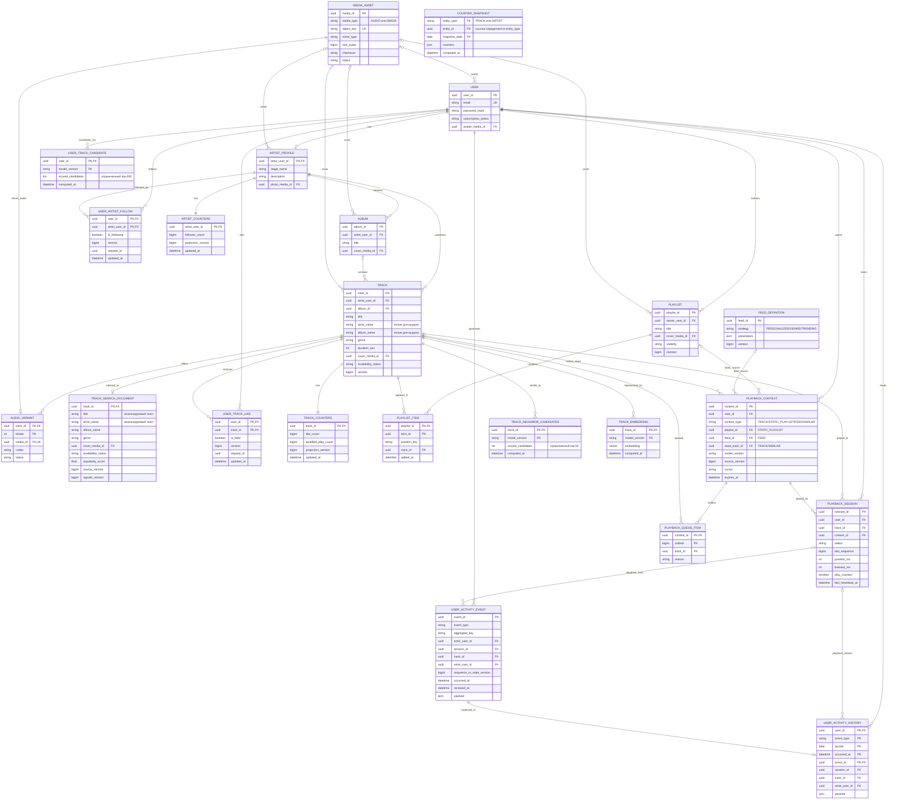
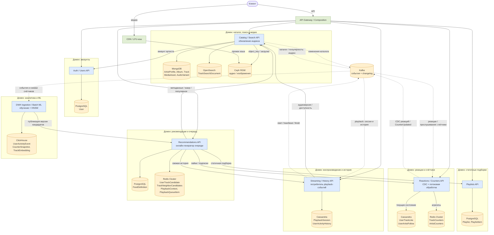

# Рассчётно-пояснительная записка для Курсовой работы по предмету "Проектирование высоконагруженных систем"

## 1. Тема и целевая аудитория

**Тип сервиса**: Музыкальный стриминг (аналог Яндекс.Музыка)

**Основной функционал MVP**: 
1) Регистрация/авторизация пользователя;
1) Возможность прослушивания треков;
1) Рекомендательная система для подбора треков по предпочтениям пользователя;
2) Поиск музыки;
4) Плейлисты: пользовательские и редакторские подборки, персональные/жанровые ленты, похожие треки;
5) Лайки треков и подписки на артистов.

**Ключевые продуктовые решения**: 
1) Поиск сразу по исполнителю и названию;
2) Рекомендательная система предварительно вычисляет наиболее вероятный список треков для пользователя.

**Ключевые функции, характеризующие сервис**: 
1) Прослушивание музыки;
2) Рекомендации музыки.

**Целевая аудитория**: ~30.5 млн человек в месяц. Основная часть аудитории сосредоточена в России (~95%) и Беларуси (~1.5%), остальные – другие страны СНГ. [^1]

## 2. Расчет нагрузки

### Продуктовые метрики


|Тип метрики | Величина|
|:--|:--|
|MAU | 30.5 млн.|
|DAU| 15-16 млн. (30.5 * 0.5) |

Коэффициент для DAU получен исходя из того, что в среднем Яндекс Плюс пользуются 21 день в месяц [^2], то есть коэффициент 21 / 30 = 0.7. С учетом того, что Яндекс Плюс использует больше людей, немного уменьшим коэффициент для Яндекс.Музыки.

Далее для всех расчетов будем использовать DAU = 15,5 млн.

**Среднее количество действий DAU-пользователя в день, по типам**

Типы действий выбраны исходя из MVP. Запросы heartbeat/finish считаются отдельно от сознательных действий пользователя; реакции входят в общий бюджет операций с плейлистами и реакциями.

|Тип действия | Количество в день на пользователя|
|:--|:--|
|Воспроизведение трека| ~ 12|
|Запрос рекомендаций| ~ 3|
|Поисковый запрос| ~ 1,5|
|Действие с плейлистом или реакция (лайк/подписка)| ~ 1 суммарно|
|Авторизация / обновление сессии| ~ 1|

Расчет количества прослушанных треков: по данным исследования РОМИР, 78% пользователей музыкальных стримингов в городах России проводят с сервисом более 30 минут в день [^3]. Поскольку это пороговое, а не среднее значение, для расчета берется оценка среднего времени прослушивания 40 минут в день на DAU-пользователя. Средняя длительность трека, по данным исследования, в 2020 году (данные Spotify) составила 3 минуты 17 секунд ~ 3,3 минуты [^4]. Тогда среднее число прослушанных треков в день: 40 / 3,3 ~ 12.

Частота обращений к поиску, рекомендациям, плейлистам и авторизации не публикуется сервисами в открытых источниках, поэтому эти величины приняты как оценки.

### Технические метрики

**Размер хранения в разбивке по типам данных**

Оценка размера каталога: по данным Forbes.ru, по состоянию на 2023 год каталог «Яндекс Музыки» насчитывал более 76 млн треков [^5]. Официальный Transparency Report сервиса указывает, что каталог еженедельно пополняется примерно на 80 тыс. единиц лицензионного контента [^6]. Считая пополнение на 2 года (104 недели): 76 + 0,08 * 104 ~ 84,3 млн, округлим до 85 млн треков.

Для адаптивного воспроизведения сервис хранит несколько версий трека под разный битрейт — режимы «Экономичное» (HE-AAC, 64 кбит/с), «Оптимальное» (AAC, 192 кбит/с) и «Превосходное» (MP3 320 кбит/с либо FLAC) [^7]. Для расчета примем упрощенно 3 сохраняемые версии на трек: 64 / 192 / 320 кбит/с. При средней длительности трека 3,3 минуты (200 сек) [^4] размер файла на каждый битрейт: 64 кбит/с -> 1,6 МБ; 192 кбит/с -> 4,8 МБ; 320 кбит/с -> 8,0 МБ; итого ~ 14,4 МБ на трек (все версии).

Бюджет метаданных каталога и эмбеддингов — ~0,5 ТБ: ~2 КБ на Track, ~2 КБ на вектор и связанные сущности. Для ~14,2 млн изображений по 0,3 МБ требуется ~4,3 ТБ; дополнительные размеры и пользовательские загрузки оцениваются отдельно.

|Тип данных | Количество единиц | Размер на единицу | Итого|
|:--|:--|:--|:--|
|Аудиофайлы каталога (3 версии битрейта на трек)| 85 млн треков| 14,4 МБ| ~ 1224 ТБ (1,2 ПБ)|
|Метаданные каталога, медиассылки и эмбеддинги| 85 млн треков и связанные сущности| по разделу 5| ~0,5 ТБ|
|Оперативные пользовательские данные (состояния, элементы плейлистов, история 7 суток, очереди с TTL)| по разделу 5| бюджет с запасом на вспомогательные поля| ~4,6 ТБ до индексов и репликации|
|UserTrackCandidate (top-200 на пользователя)| 30,5 млн| ~4 КБ| ~0,122 ТБ на версию|
|TrackNeighborCandidates (top-50 на трек)| 85 млн| ~1 КБ| ~0,085 ТБ на версию|
|Изображения| ~14,2 млн| ~0,3 МБ| ~4,3 ТБ|
|**Базовый бюджет полезных данных**| | | ~1234 ТБ; без поискового индекса, DWH, снимков счётчиков, индексов СУБД и репликации|


|Тип метрики | Величина|
|:--|:--|
|Оперативные данные в пересчёте на MAU|~0,15 МБ, усреднённый бюджет|
|Хранилище на 1 пользователя, оффлайн-кэш|0.25 Гб|

~0,15 МБ на MAU — бюджет состояний, элементов плейлистов, истории за 7 суток и очередей с TTL (раздел 5). DWH добавляет ~108,6 ТБ/год до сжатия и репликации. Офлайн-кэш 0,25 ГБ хранится на устройстве и в серверный бюджет не входит.

**RPS в разбивке по типам запросов**

Средний RPS = DAU × действий в день / 86 400. При треке 200 секунд и heartbeat раз в 30 секунд сверх start добавляются 6 heartbeat + 1 finish: 84 запроса на DAU в сутки. Это допущение; пропуски и повторы меняют фактическую нагрузку.

|Тип запроса | Средний RPS | Пиковый RPS|
|:--|:--|:--|
|Воспроизведение трека| ~ 2153| ~ 5383|
|Запрос рекомендаций| ~ 538| ~ 1345|
|Поиск| ~ 269| ~ 673|
|Операции с плейлистом и реакции суммарно| ~ 179| ~ 448|
|Авторизация| ~ 179| ~ 448|
|Playback heartbeat + finish| ~15 069| ~37 681|
|**Итого API**| ~18 387| ~45 978|

**Сетевой трафик**

Примем распределение DAU-пользователей по качеству звука: 20% - «Экономичное» (64 кбит/с), 60% - «Оптимальное» (192 кбит/с), 20% - «Превосходное» (320 кбит/с) [^7]. Средневзвешенный битрейт потока: 0,2\*64 + 0,6\*192 + 0,2\*320 = 192 кбит/с.

Суммарное время прослушивания в сутки: DAU \* 40 мин = 15,5 млн \* 40 мин = 620 млн человеко-минут/сутки = 37,2 млрд человеко-секунд/сутки. Средняя нагрузка = 37,2\*10^9 сек \* 192 000 бит/с / 86 400 сек ~ 82,7 Гбит/с; суммарный суточный объем ~ 893 ТБ/сутки.

Прослушивание распределено по суткам неравномерно (пики в утренние/вечерние часы). Примем коэффициент пик/среднее ~ 2,5 для сервисов с выраженной суточной цикличностью (аудитория сервиса сосредоточена в РФ). Пиковая нагрузка (аудио) ~ 82,7 \* 2,5 ~ 207 Гбит/с.

Принятые payload: start ~2 КБ, рекомендации ~10 КБ, поиск ~5 КБ, прочие запросы ~1 КБ. Исходный API даёт ~228 Мбит/с и 0,984 ТБ/сутки; heartbeat/finish добавляют ~301 Мбит/с и 1,302 ТБ/сутки. Итого ~0,53 Гбит/с и 2,29 ТБ/сутки без полного учёта заголовков/повторов.

Для изображений принято 5 загрузок по 50 КБ на DAU в сутки: ~3,88 ТБ/сутки и ~0,9 Гбит/с в пике. Медиа идёт через CDN и в API RPS не входит.

|Тип трафика | Пиковое потребление, Гбит/с | Суммарный суточный объем, ТБ/сутки|
|:--|:--|:--|
|Аудиопоток (стриминг)| ~ 207| ~ 893|
|API, включая playback-телеметрию| ~0,53| ~2,29|
|Изображения через CDN| ~0,9| ~3,88|
|**Итого**| ~208,4| ~899,2|

### Прирост метрик

|Метрика | Сейчас | Прирост за год|
|:--|:--|:--|
|MAU| 30,5 млн| +32% (~ +9,8 млн; ~ 27 тыс./сутки)|
|DAU| 15,5 млн| +32% (~ +5,0 млн; ~ 14 тыс./сутки)|
|Каталог| 85 млн треков| +4,9% (~ +4,16 млн; ~ 11,4 тыс./сутки)|
|Аудиофайлы каталога| ~ 1224 ТБ| ~ +60 ТБ (~ 0,16 ТБ/сутки)|
|Метаданные каталога и эмбеддинги| ~0,5 ТБ| ~+0,025 ТБ при росте каталога на 4,9%|
|Пользовательские данные| ~ 4,6 ТБ| +32% (~ +1,5 ТБ; ~ 4 ГБ/сутки)|
|UserTrackCandidate| ~0,122 ТБ| +32% (~+0,039 ТБ)|
|**Базовое полезное хранилище**| ~1234 ТБ| ~+62 ТБ/год без DWH/индексов/реплик; рост изображений и соседей условно пропорционален каталогу|
|Пиковый сетевой трафик (аудио)| ~ 207 Гбит/с| +32% (~ +66 Гбит/с)|
|Суточный объем трафика| ~899,2 ТБ/сутки| +32% (~+288 ТБ/сутки)|
|Средний API RPS| ~18 387| +32% (~+5884)|
|Пиковый API RPS| ~45 978| +32% (~+14 713)|

Прогноз: аудитория +32%/год [^1], каталог +4,16 млн треков (~4,9%). Пользовательские данные, RPS и трафик растут с аудиторией; аудиохранилище — примерно на 60 ТБ/год. Годовая скорость накопления playback-DWH вырастет со 108,6 до ~143,4 ТБ; индексы и служебные данные оцениваются отдельно.

## 3. Глобальная балансировка нагрузки

**Функциональное разбиение по доменам**

|Домен | Описание | Требования|
|:--|:--|:--|
|Auth/Users| профиль, сессии, подписки| консистентность записи|
|Catalog & Search| каталог треков, поиск| read-heavy, кэшируется|
|Recommendations| кандидаты, рецепты лент и генерация очереди| предвычисление + ограниченная онлайн-выдача|
|Playlists & Reactions| статичные плейлисты, лайки треков, подписки на артистов| согласованные личные состояния и асинхронные общие счётчики|
|Streaming| доставка аудиофайлов| доминирует по трафику|
|Activity ingestion| start/heartbeat/finish и изменения реакций| поток событий для онлайн-проекций и DWH|

Из раздела 2: пиковый аудиотрафик ~207 Гбит/с, изображения ~0,9 Гбит/с, API с heartbeat/finish ~0,53 Гбит/с. Основной объём байтов приходится на аудио, поэтому медиа раздаётся CDN, а прикладные запросы и приём событий обслуживаются core ДЦ.

**Обоснование расположения ДЦ**

Аудитория: 95% РФ, 1,5% Беларусь, ~3,5% другие страны СНГ [^1]. Внутри РФ ~70% населения живет в европейской части (25% территории), ~30% — в азиатской (Урал, Сибирь, Дальний Восток, 75% территории) [^9]. Крупнейшая точка обмена трафиком в РФ — MSK-IX (Москва), топ-5 в мире по трафику (пик 8,7 Тбит/с), с узлами в Москве и региональными площадками (Петербург, Казань, Екатеринбург и др.) [^8]. На практике Яндекс размещает основные ЦОДы кластером в 100-300 км от Москвы (Владимир, Сасово, Калуга), рядом с MSK-IX и основной массой пользователей, а не распределяет их по стране [^10].

Решение: 3 core ДЦ в Центральном федеральном округе (active-active-active, для отказоустойчивости) обслуживают прикладные API всех доменов, включая start/heartbeat/finish. Аудиобайты и изображения раздаются через CDN-узлы (Anycast) в региональных точках обмена (Москва, Петербург, Екатеринбург, Новосибирск), с пирингом в Минске и Алматы. Для небольшой доли аудитории СНГ отдельный core ДЦ в принятой модели не предусматривается.

**Расчет распределения запросов по ДЦ**

Три core ДЦ обслуживают ~18 387/45 978 среднего/пикового API RPS и ~0,53 Гбит/с. Штатно на ДЦ приходится ~6129/15 326 RPS; по N+1 каждый рассчитан на ~9194/22 989 при отказе одной площадки. Доступность хранилищ проверяется отдельно.

При допущении 90% попаданий по байтам CDN отдаёт ~186 Гбит/с, Ceph — ~21 Гбит/с. На core ДЦ приходится ~7 Гбит/с штатно и ~10,5 при отказе одного. Для изображений до измерения hit ratio резервируется дополнительно до 0,9 Гбит/с origin-трафика суммарно; API-полоса учитывается отдельно.

**Схема DNS-балансировки (GeoDNS)**

Используется для доступа к core ДЦ (auth, catalog, recs, playlists):

```
Клиент -> локальный DNS-резолвер -> авторитативный GeoDNS
       -> определяет регион резолвера и живой (health-check) ДЦ
       -> возвращает IP ближайшего/доступного core ДЦ (ДЦ-1, ДЦ-2 или ДЦ-3)
Клиент -> подключается напрямую по полученному IP
```

Слабое место — кэширование ответа на стороне резолвера/клиента (TTL): переключение при отказе ДЦ происходит не мгновенно [^11].

**Схема Anycast-балансировки**

Используется для CDN-узлов, раздающих аудиопоток: один и тот же IP-префикс анонсируется по BGP одновременно из всех точек присутствия (Москва, Петербург, Екатеринбург, Новосибирск, Минск, Алматы). DNS возвращает Anycast-адрес, а выбор площадки определяется сетевыми маршрутами и политиками BGP, а не точным географическим расстоянием [^11]. При отказе площадки её анонс должен быть отозван; переключение не ждёт истечения DNS TTL, но требует обнаружения отказа и сходимости маршрутов. Установленные соединения могут оборваться и потребовать повторного подключения.

**Механизм регулировки трафика между ДЦ**

- Core ДЦ (GeoDNS): health-check каждые N секунд; при отказе ДЦ его IP исключается из ответов, TTL записи снижен (например, до 30-60 сек) для быстрого переключения.
- Плановое перераспределение нагрузки (релизы, обслуживание) — постепенный перевод DNS-ответов/BGP-анонсов, а не резкое переключение.

## 4. Локальная балансировка нагрузки

App-серверы доменов — stateless (масштабируются балансировкой), БД — stateful; схема чтения и записи зависит от СУБД (раздел 6). App-слой разворачиваем в Kubernetes: отдельно устанавливаем **NGINX Ingress Controller** (проект nginx/kubernetes-ingress, вариант с NGINX Open Source [^19]) для L7. Для Kubernetes Service **kube-proxy** настраивает L4-правила в ядре; выбран режим nftables на совместимых Linux-узлах [^20].

**Уровни и резервирование**

```
Клиент -> L4-правила входного Service (kube-proxy/nftables) -> L7 (NGINX Ingress Controller, TLS termination, роутинг)
       -> App-под домена -> межсервисные вызовы (sidecar proxy) -> нужная СУБД (раздел 6)
```

Здесь выбран вход через Service ingress-controller. Контроллер направляет запросы к pod-адресам нужного сервиса; повторный проход через ClusterIP app-сервиса не обязателен. kube-proxy программирует правила, а не выступает отдельным последовательным HTTP-прокси.

|Уровень | Формула | Что переживает|
|:--|:--|:--|
|L4 / L7 / App-под / read-реплика (внутри ДЦ)| N+1| отказ одного узла|
|3 core ДЦ (раздел 3, между ДЦ)| N+1 на уровне ДЦ| отказ одного ДЦ целиком|

N+1 — минимум под нагрузку плюс один запасной элемент. "Элемент" может быть и отдельной машиной (внутри ДЦ), и целым ДЦ (между ДЦ) — формула та же, просто единица резервирования другая. При 3 ДЦ: под пиковую нагрузку в сумме нужно 2 ДЦ-эквивалента (каждый provisioned на 50% пика), третий — запасной; любые 2 из 3 вместе вытягивают 100%. Суммарно провижинится ~150% пиковой мощности — дешевле, чем N x 2 (две полностью независимые копии по 100% каждая, то есть 200%, или 300% для трех копий).

Отдельно стоит отметить: с ровно 2 ДЦ формулы N+1 и N x 2 физически совпадают — если нужна гарантия "1 из 2 ДЦ один вытянет всё", этот один ДЦ по-любому должен быть provisioned на 100%, другого способа нет. Разница между формулами становится ощутимой только от 3 единиц резервирования и больше — именно поэтому переход на 3 ДЦ даёт реальную экономию (150% вместо 200%), а не просто "на всякий случай".

**L3/L4: выбор способа (LVS/IPVS) — отдельный балансировщик перед edge/CDN**

Это не kube-proxy (он только для core ДЦ, см. выше) — для раздачи аудио стоит отдельный, специально настроенный LVS/IPVS-балансировщик вне Kubernetes, и вот для него способ выбирался осознанно:

|Способ | Ответ сервера | Нагрузка на LB|
|:--|:--|:--|
|NAT| идёт обратно через LB| высокая|
|IP Tunneling | идёт клиенту напрямую| только входящий трафик, но есть накладные расходы на инкапсуляцию/декапсуляцию на каждый пакет|
|Direct Routing (DR, меняется MAC, не IP)| идёт клиенту напрямую| LB обрабатывает входящие пакеты, объёмный ответ обходит его|

Берём DR: при 186 Гбит/с суммарного исходящего аудиотрафика важно, чтобы ответ обходил LB. Входящие пакеты всё равно требуют CPU и пропускной способности; пределы по PPS/CPS и сеть проверяются отдельно. Серверы и балансировщик каждой CDN-площадки размещаются в общей L2-сети. Для API в core ДЦ (~0,53 Гбит/с) используются правила Service kube-proxy/nftables, отдельный DR-балансировщик не нужен. Для выделенного LVS-балансировщика keepalived выполняет проверки и VRRP-переключение виртуального IP на резервный узел.

**Входящие запросы (L7)**: настраиваем least connections (least_conn), поскольку время обработки поисковых запросов различается. Число активных соединений — приближение занятости, а не точная загрузка сервера; преимущество перед round-robin проверяется на целевом профиле нагрузки. Разбор случайной маршрутизации [^12] иллюстрирует риск очередей, но сам по себе не доказывает превосходство алгоритма для нашего сервиса.

**Межсервисные запросы**: sidecar proxy на стороне вызывающего сервиса получает адреса готовых экземпляров через discovery (например, headless Service с DNS-именем в CoreDNS) и применяет настроенную балансировку без возврата к внешнему Ingress. CoreDNS разрешает имена; готовность pod определяется проверками Kubernetes, а оценка занятости — политикой прокси.

**Схема отказоустойчивости**

|Что отказало | Кто обнаруживает | Что происходит|
|:--|:--|:--|
|L4/L7/app-узел| health-check| узел исключается, N+1 покрывает|
|Read-реплика БД| health-check| чтение уходит на оставшиеся (N+1)|
|Весь core ДЦ| внешние health-check, обновление GeoDNS (раздел 3)| оставшиеся 2 из 3 ДЦ принимают по 50% пика (N+1); переключение зависит от DNS-кэшей и доступности реплик данных|
|CDN-сервер / вся edge-площадка| локальные проверки / отзыв BGP-анонса| сервер исключается локально; при потере площадки маршруты сходятся к другой, клиенту может потребоваться повторное подключение|

**Расчет количества балансировщиков**

У API и медиа разные профили нагрузки. Для API, включая playback-телеметрию, проверяются обработка запросов и TLS; стоимость handshakes существенна при частом создании соединений. Медиа передаёт большой объём байтов по длительным соединениям, поэтому важна пропускная способность сети. При повторном использовании HTTPS-соединения новый handshake не требуется для каждого сегмента или heartbeat.

*API-слой.* Ориентир бенчмарков [^16][^17] — ~10 000 новых HTTPS-соединений/с на узел. При 22 989 RPS на ДЦ и одном новом соединении на запрос: ceil(22 989 / 10 000) = 3 рабочих узла, с N+1 — 4 на ДЦ, 12 суммарно. Keep-alive/resumption [^18] снижают CPS; оценка проверяется на целевой конфигурации.

*Edge/CDN-слой, ограничитель — пропускная способность сети.* Пиковый аудиотрафик с edge/CDN-узлов — 186 Гбит/с (раздел 3, 90% от 207 Гбит/с). При условной пропускной способности одного узла 10 Гбит/с (например, агрегированный канал 2x10GbE) — нужно узлов: 186 / 10 = 18,6 -> округляем до 19. Эти узлы физически распределены по ~4 точкам присутствия (Москва, Петербург, Екатеринбург, Новосибирск), то есть в среднем ~5 узлов на точку; добавляя резервирование N+1 в каждой точке отдельно (а не один общий запасной на всю сеть — точки физически разделены и не могут "одолжить" мощность друг у друга при отказе) — итого около 19 + 4 = 23 узла.

*Вывод.* После добавления heartbeat/finish API-слой оценивается в 12 ingress-узлов, edge/CDN — около 23 узлов по аудиобайтовой нагрузке. Оба числа условны до нагрузочных испытаний и проверки распределения по площадкам; ~0,9 Гбит/с изображений требуют отдельной проверки кэша и origin, хотя при исходном суммарном округлении число рабочих edge-узлов остаётся 19.

## 5. Логическая схема БД

Онлайн-контур хранит состояния и проекции; DWH — архив UserActivityEvent для обучения и сверки.



Прослушивание засчитывается один раз на session_id после min(30 секунд, длительность трека), без учёта перемотки.

### 5.1. События и DWH

|Тип события | Основные данные | Назначение|
|:--|:--|:--|
|PLAYBACK_STARTED| session_id, track_id, context_id, source| начало воспроизведения|
|PLAYBACK_HEARTBEAT| session_id, sequence, position_ms, listened_ms| активность и продолжение|
|PLAYBACK_FINISHED| session_id, listened_ms, percent_listened, reason| история и обучение|
|TRACK_LIKE_CHANGED| user_id, track_id, is_liked, state_version| состояние и счётчик лайков|
|ARTIST_FOLLOW_CHANGED| user_id, artist_user_id, is_following, state_version| подписка и число подписчиков|

### 5.2. Объёмы и нагрузка

Оценки полезных данных приведены до индексов и репликации. Для состояния реакции и элемента плейлиста принято 80 байт.

|Сущности | Основание | Объём|
|:--|:--|:--|
|User / ArtistProfile / Album| 30,5 млн слушателей; 5,7 млн артистов; 8,5 млн альбомов| ~30 / 2,3 / 3,4 ГБ; пересечение аккаунтов уточняется|
|Track| 85 млн × 2 КБ| ~0,17 ТБ|
|MediaAsset / AudioVariant| 269,2 млн × 256 байт / 255 млн × 128 байт| ~68,9 / 32,6 ГБ|
|Аудио / изображения| три аудиокачества; 14,2 млн изображений × 0,3 МБ| ~1224 / 4,3 ТБ|
|TrackSearchDocument| до 85 млн документов| индекс измеряется после настройки анализаторов|
|UserTrackLike| 250 лайков на MAU × 80 байт| ~0,61 ТБ плюс неактивные версии|
|UserArtistFollow| 10 подписок на MAU × 80 байт| ~24,4 ГБ|
|Playlist / PlaylistItem| 10 плейлистов на MAU, по 50 элементов| ~61 ГБ / 1,22 ТБ|
|UserActivityHistory| playback-события × 7 суток × 200 байт| ~2,08 ТБ плюс реакции|
|Контексты и очереди| до 2 на DAU, 200 элементов × 32 байта, TTL 24 часа| до ~0,2 ТБ плюс метаданные|
|TrackCounters / ArtistCounters / CounterSnapshot| агрегаты и ежедневные снимки| зависит от числа шардов и срока хранения|
|UserTrackCandidate / TrackNeighborCandidates| top-200 на MAU / top-50 на трек, 20 байт на кандидата| ~0,122 / 0,085 ТБ на версию|
|TrackEmbedding| 85 млн × 2 КБ| ~0,17 ТБ; ANN-память отдельно|
|UserActivityEvent, DWH| 186 млн воспроизведений/сутки × 8 событий × 200 байт| ~108,6 ТБ/год плюс реакции|

## 6. Физическая схема БД

|Сущности | Хранилище | Ключи и организация | Надёжность|
|:--|:--|:--|:--|
|User| PostgreSQL| PK user_id, unique email| Patroni, primary + 2 реплики, WAL и бэкапы|
|ArtistProfile / Album / Track| MongoDB| ID; индексы artist_user_id/album_id; шарды по тестам| replica set, снимки|
|MediaAsset / AudioVariant| MongoDB| media_id; unique (track_id, bitrate)| снимки и сверка с объектами|
|TrackSearchDocument| OpenSearch| _id=track_id, текстовый индекс и фильтры| реплики, перестроение из каталога [^29]|
|Аудио и изображения| Ceph RGW| object_key; востребованные копии на CDN| репликация ×3, версии/резервирование контента|
|UserTrackLike / UserArtistFollow| Cassandra| partition=user_id, clustering=ID объекта; LWT по version, SERIAL/QUORUM| RF=3, snapshot и CDC [^28]|
|Playlist / PlaylistItem| PostgreSQL| playlist_id; индекс порядка; правка элемента и revision транзакционно| hash-партиции по playlist_id, WAL и бэкапы|
|FeedDefinition| PostgreSQL| feed_id/version; параметры генератора| история конфигурации и бэкапы|
|PlaybackContext / QueueItem| Redis Cluster| общий hash tag контекста, атомарная страница и cursor; TTL 24 часа| реплики, failover Cluster [^26]; при потере контекст пересоздаётся|
|UserTrackCandidate / TrackNeighborCandidates| Redis Cluster| user_id/track_id + model_version, компактные снимки| пересчёт; закреплённые версии живут до истечения контекстов|
|PlaybackSession| Cassandra| session_id; обновление только с новым sequence, TTL 7 суток| журнал событий|
|UserActivityHistory| Cassandra| partition=(user_id, event_type, day), сортировка по времени/event_id; TTL 7 суток| переигрывание журнала|
|TrackCounters / ArtistCounters| Redis Cluster| (entity_id, shard), абсолютное значение и версия| changelog, снимки и сверка|
|CounterSnapshot| ClickHouse| ORDER BY (entity_type, entity_id, snapshot_date)| репликация и бэкапы|
|UserActivityEvent| Kafka -> ClickHouse| ключ агрегата; DWH сортируется по типу/времени/user_id/event_id| Kafka RF=3, retention 7 суток; DWH 1 год|
|TrackEmbedding| ClickHouse| (model_version, track_id), batch-доступ| версия модели и повторный расчёт|

CDC доставляет изменения реакций в Kafka. Обработчик устраняет повторы по event_id/version и публикует идемпотентные проекции; состояние сохраняется с changelog [^27][^28].

Реплики и кворумы размещаются с расчётом на потерю одного ДЦ.

## 7. Алгоритмы

### 7.1. Генерация рекомендаций и очереди

**Офлайн, периодически:**

1. Собрать признаки из DWH и снимков лайков/подписок; накопленный listened_ms из heartbeat повторно не суммировать.
2. Обучить коллаборативную модель, сохранить TrackEmbedding и построить HNSW.
3. По векторам пользователей получить top-200 UserTrackCandidate, по векторам треков — top-50 TrackNeighborCandidates. Передать готовую model_version в Recommendations API для публикации в Redis.

|Контекст | Источник следующей порции|
|:--|:--|
|TRACK| выбранный трек; затем конец или переход к SIMILAR|
|STATIC_PLAYLIST| PlaylistItem по порядку, с revision|
|PERSONALIZED («Моя волна»)| персональные кандидаты, соседи и популярное как fallback|
|GENRE / TRENDING| каталог с фильтром жанра и popularity_score|
|SIMILAR| соседи seed-трека, затем fallback|

**Онлайн, при пополнении ленты/SIMILAR:**

1. Объединить кандидатов из таблицы выше с соседями последних положительных действий пользователя; отфильтровать недоступные треки, повторы и неподходящий жанр.
2. Пересчитать score = α·base_score + β·recent_affinity + γ·is_followed_artist. Сигналы нормализованы в [0,1], веса подбираются на отложенных данных; recent_affinity — близость по снимкам соседей до пяти последних прослушанных/лайкнутых треков.
3. Отсортировать по score и жадно выбрать до 20 треков, не допуская более двух подряд от одного артиста. При нехватке — популярное в заданном жанре, затем конец выдачи.
4. Атомарно сохранить страницу и cursor в очереди до 200 элементов; повтор cursor возвращает ту же страницу. Свежие действия влияют на следующую порцию без ожидания batch-пересчёта.

Для TRACK и STATIC_PLAYLIST ранжирование не применяется: сохраняется выбранный трек или порядок PlaylistItem.

Модель/источник закреплены в PlaybackContext. При смене revision контекст обновляется; при нехватке кандидатов — fallback или конец выдачи.

### 7.2. Вытеснение кэша CDN

**Алгоритм**: LFU по частоте обращений за последние 24 часа. Он удерживает актуальные хиты и постепенно забывает старую популярность.

1. Ключ объекта — track_id + битрейт; при запросе обновляется частота.
2. При промахе файл получается из Ceph, отдаётся клиенту и кэшируется.
3. При нехватке места удаляются наименее частые объекты; при равенстве — давно не использованные.
4. Устаревшие обращения исключаются из статистики окна.

**Структуры**: хэш-таблица объектов, счётчики по часовым корзинам и min-heap кандидатов на удаление. Цена решения — память статистики и обновление приоритетов.

**Альтернативы**: LRU учитывает давность, FIFO — порядок добавления; предиктивный прогрев требует прогноза спроса. LFU выбран из-за перекоса к популярным трекам. Доля попаданий 90% по байтам остаётся допущением: её проверяют на трассе запросов и при необходимости пересчитывают origin-полосу.

## 8. Технологии

Выбор технологий сводится к задачам ниже; расчётные мощности проверяются испытаниями.

|Категория | Технология | Назначение | Альтернативы | Обоснование|
|:--|:--|:--|:--|:--|
|Оркестрация и деплой|Kubernetes|stateless app-слой|VM / Docker Compose|размещение, перезапуск и масштабирование pod; ingress устанавливается отдельно|
|Оркестрация и деплой|GitLab CI + ArgoCD|CI/CD в трёх ДЦ|ручной kubectl apply|сборка/проверки и воспроизводимая доставка конфигурации из Git|
|Балансировка и сеть|NGINX Ingress Controller (nginx/kubernetes-ingress, OSS)|входящий HTTP(S)|Traefik / HAProxy|TLS, маршрутизация, least_conn; выбран поддерживаемый проект NGINX [^19]|
|Балансировка и сеть|kube-proxy, nftables|Kubernetes Service|iptables / eBPF-CNI|L4-правила на совместимых Linux-узлах; IPVS-режим kube-proxy устарел [^20]|
|Балансировка и сеть|LVS/IPVS DR + keepalived|балансировка CDN-площадки|NAT / Tunneling|ответ обходит LB; общая L2-сеть, VRRP-переключение VIP|
|Балансировка и сеть|GeoDNS|выбор core ДЦ|Anycast|простота для трёх площадок; переключение ограничено DNS TTL|
|Балансировка и сеть|Anycast/BGP|выбор CDN-площадки|GeoDNS|смена маршрута без DNS TTL; остаётся задержка сходимости BGP|
|Балансировка и сеть|Sidecar proxy (Envoy)|межсервисные вызовы|клиентская балансировка|общие политики тайм-аутов/балансировки; требует discovery адресов экземпляров|
|Балансировка и сеть|CoreDNS|DNS-имена сервисов|Consul|использует сведения Kubernetes; загрузку pod не измеряет|
|Хранилища|PostgreSQL + Patroni + PgBouncer|аккаунты, статичные плейлисты, рецепты лент|MySQL|транзакции для элементов/revision, failover и пул соединений|
|Хранилища|MongoDB|каталог и метаданные медиа|PostgreSQL|документная модель и чтения по ID; шарды по результатам тестов|
|Поиск|OpenSearch|TrackSearchDocument|индекс MongoDB / Elasticsearch|текстовый индекс, жанровые фильтры; перестраивается из каталога [^29]|
|Хранилища|Cassandra + CDC-потребитель|лайки, подписки, сессии, история|PostgreSQL / распределённый KV-store|доступ по пользовательским ключам; LWT/QUORUM для реакций, TTL истории [^28]|
|Хранилища|Redis Cluster|кандидаты, очередь, счётчики|PostgreSQL / MongoDB|доступ по ключу, TTL и атомарные операции; реплики и восстановление|
|Хранилища|Kafka|события и changelog|прямая запись в проекции|входные события хранятся 7 суток; changelog состояния — compact; порядок по агрегату и replay [^27]|
|Обработка событий|Kafka Streams|дедупликация и проекции|Flink / собственные потребители|состояние с changelog; внешние проекции записываются идемпотентно [^27]|
|Хранилища|ClickHouse|DWH, снимки счётчиков, эмбеддинги|PostgreSQL / batch-движок|колоночные чтения для аналитики и обучения|
|Хранилища|ClickHouse Keeper|координация реплик|ZooKeeper|компонент экосистемы ClickHouse; требуется отказоустойчивый кворум [^21]|
|Хранилища|Ceph RGW|аудио и изображения|managed S3|контроль размещения/репликации, S3 API; самостоятельная эксплуатация|
|Кэширование|собственный HTTP-кэш на NVMe, LFU с окном|CDN|Varnish LRU / NGINX proxy_cache|частота удерживает хиты; LFU реализуется отдельно, штатный Varnish использует LRU [^22]|
|Рекомендации|HNSW|подготовка снимков кандидатов|Annoy / brute-force|приближённый поиск и инкрементальное добавление; качество/память измеряются [^23]|
|Доступ|OAuth 2.0, JWT|доступ к API|серверные сессии|OAuth — авторизация, JWT — токен с локальной проверкой; отзыв требует отдельного механизма [^24]|
|Эксплуатация|Prometheus + Grafana + Alertmanager|метрики и оповещения|Zabbix|сбор, визуализация и доставка тревог; failover выполняют сами компоненты [^25]|
|Эксплуатация|ELK/EFK или Loki|централизованные логи|Graylog / OpenSearch|единый поиск ошибок по сервисам и ДЦ|
|Тестирование|Yandex.Tank / k6 / Gatling|нагрузочные испытания|собственный генератор|воспроизводимые RPS/CPS, p95/p99 и доля ошибок|
|Тестирование|Chaos Mesh|эксперименты со сбоями|собственные сценарии|проверка pod/узлов/сети; отказ ДЦ требует отдельных сценариев|

## 9. Обеспечение надёжности

Резервирование и репликация описаны в разделах 3, 4 и 6. Дополнительные меры:

|Паттерн | Где применяется | Поведение|
|:--|:--|:--|
|Bulkhead — изоляция ресурсов| поиск, playback, ML| отдельные пулы и квоты; перегрузка одного домена не забирает ресурсы остальных|
|Graceful shutdown| API| снять readiness, завершить текущие запросы перед остановкой|
|Circuit breaker + retry| межсервисные вызовы| тайм-ауты, временное прекращение вызовов при сбоях; ограниченные повторы с backoff/jitter|
|Fencing| primary БД| при переключении запретить запись старому primary, исключив два активных основных узла|
|Backpressure| события плеера| ограничить буферы и темп приёма; неподтверждённые события повторять с тем же event_id|
|Graceful degradation| рекомендации и счётчики| при сбое ML — прежняя версия; при сбое счётчика — карточка без числа; недоступность личного лайка возвращает ошибку|
|Saga с компенсацией| публикация медиа| PENDING -> загрузка аудио -> READY; при отмене удалить незавершённые объекты|
|Защита от cache stampede| CDN| объединять одинаковые загрузки и ограничивать трафик к Ceph при восстановлении кэша|

## 10. Схема проекта

Service layer + API-composition (лекция 9, слайды 14–20). Хранилища закреплены за доменами; чужие данные доступны через API владельца или события.



Сплошные стрелки — API/операции с хранилищем, пунктир — события. API-composition объединяет каталог, личные реакции и счётчики для выдачи карточек. Блоки БД — логические области кластеров из раздела 6; сервисы и БД развёрнуты отдельно.


[^1]: [Аудитория «Яндекс Музыки» превысила 30,5 млн человек в месяц](https://www.sostav.ru/publication/auditoriya-yandeks-muzyki-prevysila-30-5-mln-chelovek-v-mesyats-79308.html)
[^2]: [Число подписчиков Яндекс Плюса достигло 30 миллионов](https://yandex.ru/company/news/03-07-02-2024)
[^3]: [РОМИР: 85% жителей городов России пользуются музыкальными стриминговыми сервисами](https://romir.ru/feed/romir-85-jiteley-gorodov-rossii-polzuyutsya-muzykalnymi-strimingovymi-servisami)
[^4]: [Средняя длина песен с годами сокращается](https://www.kommersant.ru/doc/5170250) (Коммерсантъ, со ссылкой на исследование UCLA)
[^5]: [Более 4000 единиц контента удалены с «Яндекс Музыки» из-за «фейков» и ЛГБТ-пропаганды](https://www.forbes.ru/forbeslife/499638-bolee-4000-edinic-kontenta-udaleny-s-andeks-muzyki-iz-za-fejkov-i-lgbt-propagandy) (Forbes.ru — цифра «более 76 млн треков», 2023)
[^6]: [Transparency Report | Яндекс Музыка](https://yandex.ru/support/music/ru/rules/transparencyreport)
[^7]: [Качество звука | Яндекс Музыка](https://yandex.ru/support/music/ru/listening/quality)
[^8]: [MSK-IX вступает в клуб «Т»](https://www.msk-ix.ru/news/129/) (официальная новость MSK-IX о пиковой нагрузке 8,7 Тбит/с и топ-5 в мире)
[^9]: [Почему 69% россиян живут в европейской части России](https://www.ixbt.com/live/travel/pochemu-69-rossiyan-zhivut-v-evropeyskoy-chasti-rossii-kotoraya-zanimaet-lish-20-territorii-strany.html) (со ссылкой на данные Росстата)
[^10]: [«Яндекс» построит новый дата-центр во Владимирской области](https://servernews.ru/1129768)
[^11]: [What is Anycast? How does Anycast Work?](https://www.cloudflare.com/learning/cdn/glossary/anycast-network/) (Cloudflare Learning Center)
[^12]: [Heroku's Ugly Secret](https://genius.com/James-somers-herokus-ugly-secret-annotated) (James Somers, разбор проблемы случайной маршрутизации запросов на Heroku)
[^13]: [Maglev: A Fast and Reliable Software Network Load Balancer](https://research.google.com/pubs/pub44824.html) (Google)
[^14]: [DPVS](https://github.com/iqiyi/dpvs) — high performance Layer-4 load balancer based on DPDK (open source)
[^15]: [nfware — Virtual Load Balancer](https://nfware.com/virtual-load-balancer) (российская разработка сетевого балансировщика)
[^16]: [Testing the Performance of NGINX and NGINX Plus Web Servers](https://blog.nginx.org/blog/testing-the-performance-of-nginx-and-nginx-plus-web-servers) (nginx, 2017, CPS для HTTPS-запросов)
[^17]: [Testing the Performance of NGINX Ingress Controller for Kubernetes](https://blog.nginx.org/blog/testing-performance-nginx-ingress-controller-kubernetes) (nginx, 2019, TPS)
[^18]: [Testing TLS Session Resumption](http://vincent.bernat.im/en/blog/2011-ssl-session-reuse-rfc5077.html) (Vincent Bernat, сбор статистики по использованию SSL session tickets через tcpdump)
[^19]: [NGINX on Kubernetes](https://kubernetes.nginx.org/) — различие поддерживаемого NGINX Ingress Controller и завершившего поддержку community ingress-nginx; [настройка балансировки](https://docs.nginx.com/nginx-ingress-controller/configuration/global-configuration/configmap-resource/).
[^20]: [Kubernetes: Virtual IPs and Service Proxies](https://kubernetes.io/docs/reference/networking/virtual-ips/) — роль kube-proxy, режим nftables и устаревание режима IPVS с версии 1.35.
[^21]: [ClickHouse Keeper](https://presentations.clickhouse.com/meetup54/keeper.pdf) — материал разработчиков о режимах запуска и координации.
[^22]: [Varnish: Configuring Varnish](https://docs.varnish-software.com/book/operations/configuring-varnish/) — штатное вытеснение LRU при нехватке места.
[^23]: [hnswlib](https://github.com/nmslib/hnswlib) — инкрементальное построение HNSW; [Annoy](https://github.com/spotify/annoy) — статический индекс после build.
[^24]: [OAuth 2.0, RFC 6749](https://www.rfc-editor.org/rfc/rfc6749), [JWT, RFC 7519](https://www.rfc-editor.org/rfc/rfc7519), [OpenID Connect Core](https://openid.net/specs/openid-connect-core-1_0.html) — разграничение авторизации, формата токена и аутентификации.
[^25]: [Prometheus: Overview](https://prometheus.io/docs/introduction/overview/) — сбор метрик, визуализация и обработка оповещений.
[^26]: [Redis Sentinel](https://redis.io/docs/latest/operate/oss_and_stack/management/sentinel/) — высокая доступность Redis вне Redis Cluster.

[^27]: [Apache Kafka: Design](https://kafka.apache.org/design/) — порядок в партициях, транзакции и границы exactly-once при работе с внешними хранилищами.
[^28]: [Apache Cassandra: Change Data Capture](https://cassandra.apache.org/doc/stable/cassandra/managing/operating/cdc.html) — чтение сохранённых мутаций, необходимость потребителя и ограничение CDC-пространства.
[^29]: [OpenSearch: Text analysis](https://docs.opensearch.org/latest/analyzers/) — анализ текстовых полей и инвертированный индекс.

[^30]: [Patroni: Replication modes](https://patroni.readthedocs.io/en/latest/replication_modes.html) — synchronous_mode, synchronous_mode_strict и выбор реплики.
[^31]: [Redis Cluster specification](https://redis.io/docs/latest/operate/oss_and_stack/reference/cluster-spec/) — асинхронная репликация и возможная потеря подтверждённых записей при failover.
